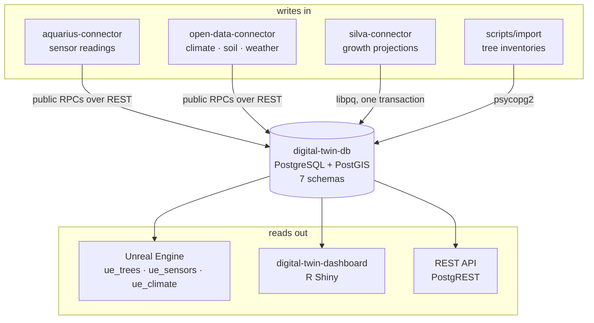
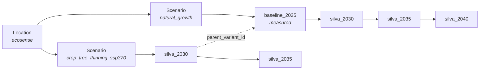

# digital-twin-db

The data tier of the forest digital twin — a self-hosted Supabase stack over PostgreSQL/PostGIS
that holds the forest, its measurements, and every version of it through time.

[](https://doi.org/10.5281/zenodo.21509858)
[](https://www.gnu.org/licenses/agpl-3.0)

A forest twin is not one dataset. It is tree inventories, LiDAR scans, sensor time series,
imagery, growth projections and site conditions, all describing the same trees at different
moments and from different instruments. This repo is the schema that lets them coexist
without any one of them overwriting another — and the API that serves any of it to a VR
scene, an R dashboard or an analysis script from a single flat query.

## Where this sits



The data-provider connectors (aquarius, open-data) reach the database **only** through public
RPCs over REST with the service-role key — no SQL, no package dependency in either direction —
so a new data provider is a new connector repo rather than a change here. silva-connector and
the dashboard are the deliberate exceptions: they read the base tables directly (silva-connector
also writes them), as listed in [AGENTS.md](AGENTS.md#consumers-that-read-base-tables-directly).
The import scripts in `scripts/import/` connect with psycopg2.

## The idea that shapes the schema

**Location → Scenario → Variant.**



A **Location** is a site. It owns its own **Scenarios**, each one combination of a management
regime (`shared.management_regimes`) and a climate pathway (`shared.climate_pathways`), unique
per location; scenarios of regime `none` (`ssp126` …) hold acquired climate data only. Each
Scenario owns a chain of **Variants** (`shared.variants`) — snapshots of the stand, one per
time step or projection, linked by `parent_variant_id`. The measured `baseline_2025` lives in
`natural_growth`; every other projection chain starts from it.

`trees.trees` holds one row per tree per variant (`variant_id`). That is what makes
`GET /ue_trees?variant_id=eq.<id>` return "the forest as it looked, or will look, at time X"
in one flat query — and it is why **every query against `trees.trees` must filter on variant**,
since a measured tree sits there alongside its projections. `pointclouds.point_clouds` and
`environments.environments` attach to a scenario (`scenario_id`, `variant_type_id` and a
free-text `variant_name`), not to a variant row.

Full model and query patterns: [docs/variant-scenario-model.md](docs/variant-scenario-model.md).

## Seven schemas

| Schema | Holds |
|--------|-------|
| `shared` | locations, plots, scenarios, management_regimes, climate_pathways, variants, variant_types, species, campaigns, soil_types, climate_zones, management_events, disturbance_events, processes and process_parameters, attribute_provenance, processing_jobs, audit_log, account_events |
| `trees` | trees (persistent `tree_entity_id`), stems, phenology_observations, growth_simulations + simulation_runs, qsms + qsm_cylinders, tree_part_types + tree_graph_edges, roots, crown_foliage_profiles, tree_status and classification tables |
| `pointclouds` | point_clouds (file paths, processing status and lineage), scanner_types, scanners |
| `sensor` | sensors, sensor_types, units, sensor_readings, sensor_tree_links |
| `environments` | environments — temperature, humidity, soil moisture, nutrients, from sensors, manual entry or models |
| `imagery` | images with spatial metadata and camera parameters |
| `forest_floor` | deadwood, ground_vegetation — plot-level surveys, not tied to a tree |

Every table and column: [docs/database-dictionary.md](docs/database-dictionary.md) (generated
from the database).

The `trees` QSM, part-type, graph-edge, root and crown-profile tables line up with the
CityGML-conformant conceptual tree model of Ambarwari et al. (2024) — see
[docs/citygml-qsm-mapping.md](docs/citygml-qsm-mapping.md).

Most tables carry **row-level security**. **Audit logging** with user attribution records every
field changed by an `UPDATE` on the tables whose values change after entry: `trees.trees`,
`trees.stems`, `trees.phenology_observations`, `environments.environments`,
`pointclouds.point_clouds`.

## What the stack gives you

PostgreSQL + PostGIS, PostgREST (auto-generated REST from the schema), a realtime WebSocket
server, GoTrue auth with RLS, an S3-compatible storage API for point clouds, Deno edge
functions, and Supabase Studio.

## Initialization is schema-only

`docker compose up -d` gives you schemas, indexes, constraints, RLS policies, audit
functions, API views, and reference data (species, soil types, climate zones) loaded from
CSV — and **empty user tables**. Trees, sensors and readings are a separate, deliberate
import step.

| Files | What they do |
|-------|--------------|
| `10-baseline-schema.sql` | Point-in-time schema snapshot (2026-07-17) |
| `11`–`29`, `29a`, `32`+ | Additive schema changes made since that snapshot — each adds, never restructures an earlier file's objects. A schema file the lookup loaders depend on must sort before `30-`; once `11`–`29` are used, add a letter suffix (`29a-`) |
| `30`–`31` | Load the lookup CSVs and register their refresh functions |

The gap around 30–31 is historical: the baseline consolidated the former 10–29 and 32–37
files, and the two lookup files were left in place (background in the knowledge hub).

Keeping lookups in CSV means species or locations can be edited and refreshed without
rebuilding the database. **A data fix in a lookup table needs both a migration and the CSV**
— change only one and the next rebuild reverts it.

Schema history lives in `supabase/migrations/` (Supabase CLI); the workflow is in
[AGENTS.md](AGENTS.md).

## Quick start

```bash
cd docker
docker compose up -d      # ~30 s until all services report healthy
docker compose ps
```

| Access point | URL |
|--------------|-----|
| Supabase Studio | <http://localhost:54323> |
| REST API (Kong) | <http://localhost:8000/rest/v1> |
| PostgreSQL | `localhost:5432` (Supavisor pooler) |

Production (dt.unr) serves the API only at `https://dt.unr.uni-freiburg.de/db` (REST under
`/db/rest/v1`), on port 443; see [docs/deployment-guide.md](docs/deployment-guide.md).

Importing data, API usage, `psql` access, requesting jobs, reset, operation and troubleshooting are in
**[RUNBOOK.md](RUNBOOK.md)**.

`docker/.env` holds database passwords, JWT secrets and API keys. It is gitignored — never
commit it, and regenerate everything before any deployment.

## Documentation

| You want | Read |
|----------|------|
| Install, import, API, reset, troubleshooting | [RUNBOOK.md](RUNBOOK.md) |
| Schema data dictionary, API spec, data access, deployment | [docs/](docs/README.md) |
| Why the variant model, the CityGML alignment, provenance design, scaling decisions | XR Future Forests Lab knowledge hub — `03-DATA-TIER/digital-twin-database` |
| Unreal integration | knowledge hub — `05-PRESENTATION-TIER/data-fetcher-guide` |
| Contributing | [CONTRIBUTING.md](CONTRIBUTING.md) |
| Release history | [CHANGELOG.md](CHANGELOG.md) |

## License

Licensed under the
[GNU Affero General Public License v3.0 or later](https://www.gnu.org/licenses/agpl-3.0).
You are free to use, study, modify, and redistribute this software. If you run a modified
version on a server that users interact with over a network, you must make the modified
source available to those users. See [LICENSE](LICENSE).

## Citation

[](https://doi.org/10.5281/zenodo.21509858)

If you use this database or its schema in a publication, please cite it. See
[CITATION.cff](CITATION.cff) for machine-readable metadata, or:

> Sperlich, M. (2026). Forest Digital Twin Database - A Supabase-powered PostgreSQL/PostGIS
> Schema (Version 2.0.0). University of Freiburg. https://doi.org/10.5281/zenodo.21509858
