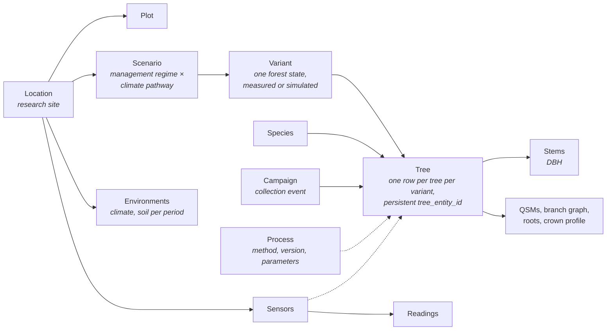
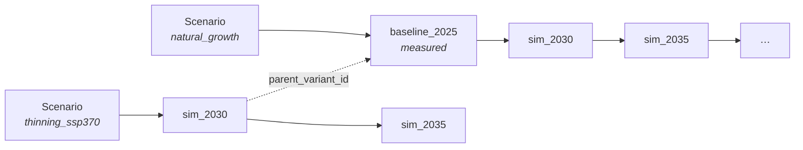
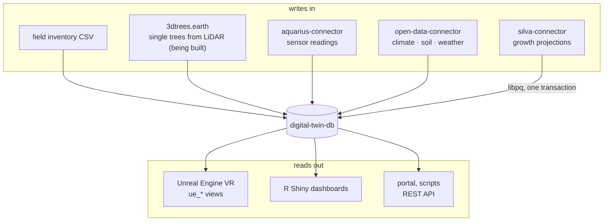

# digital-twin-db

**A single-tree inventory database for forest digital twins.** PostgreSQL/PostGIS with a
generated REST API, self-hosted as a Supabase stack.

[](https://doi.org/10.5281/zenodo.21509858)
[](https://www.gnu.org/licenses/agpl-3.0)

Every tree is a record with a persistent identity. Field inventories, trees derived from LiDAR,
sensor time series, site conditions and growth projections all attach to that record, each
kept apart by where it came from, so nothing overwrites anything else. Any client reads the
result through the same API: a VR scene, a dashboard, an analysis script in Python or R.

It is meant for research groups and platforms that hold single-tree data and want one shared
place for it, with the provenance kept.

## Database architecture

### The core model: one row per tree per forest state



A **location** is a site with its plots, sensors and site conditions. It owns **scenarios**,
each one combination of a management regime (`shared.management_regimes`) and a climate
pathway (`shared.climate_pathways`). A scenario owns a chain of **variants**
(`shared.variants`): snapshots of the stand, one per time step or projection, linked by
`parent_variant_id` so a client can walk the timeline.



`trees.trees` holds **one row per tree per variant**. `tree_entity_id` stays the same for one
physical tree across every measurement and projection, which is what lets
`GET /rest/v1/ue_trees?variant_id=eq.<id>` return "the forest as it looked, or will look, at
time X" in one flat query. It also means **every query against trees must filter on variant**,
because a measured tree sits beside its projections. Point clouds and environments attach to
a scenario rather than to a single variant.

Model, query patterns and examples: [docs/variant-scenario-model.md](docs/variant-scenario-model.md).

### Provenance: a measurement and a model output are never confused

| Mechanism | What it records |
|-----------|-----------------|
| Variant type (`shared.variant_types`) | whether a whole forest state was measured or simulated; repeated on every tree row |
| Campaign (`shared.campaigns`) | the collection event behind a measurement: `field_inventory`, `lidar_flight`, `drone_survey`, `sensor_deployment`, `manual_update` |
| Process (`shared.processes`, `process_parameters`) | the method, version and parameters behind every derived or simulated value, through `process_id` |
| Attribute provenance (`shared.attribute_provenance`) | source, version, licence and fetch time of each acquired site attribute |
| Audit log | every field changed by an `UPDATE` on trees, stems, phenology, environments and point clouds, with the account, API role or database role that changed it and the reason; readable by curators |

Details: [docs/derived-value-provenance.md](docs/derived-value-provenance.md),
[docs/run-provenance.md](docs/run-provenance.md).

### Seven schemas

| Schema | Holds |
|--------|-------|
| `shared` | locations, plots, sampling_designs, inclusion_rules and strata, scenarios, management_regimes, climate_pathways, variants, variant_types, species, campaigns, soil_types, climate_zones, management_events, disturbance_events, processes and process_parameters, attribute_provenance, processing_jobs, audit_log, account_events |
| `trees` | trees (persistent `tree_entity_id`), stems, phenology_observations, growth_simulations + simulation_runs, qsms + qsm_cylinders, tree_part_types + tree_graph_edges, roots, crown_foliage_profiles, tree_status and classification tables |
| `point_clouds` | point_clouds (file paths, processing status and lineage), scanner_types, scanners |
| `sensor` | sensors, sensor_types, units, sensor_readings, sensor_tree_links |
| `environments` | environments: temperature, humidity, soil moisture, nutrients, from sensors, manual entry or models |
| `imagery` | images with spatial metadata and camera parameters |
| `forest_floor` | deadwood, ground_vegetation: plot-level surveys, not tied to a tree |

Every table and column: [docs/database-dictionary.md](docs/database-dictionary.md) (generated
from the database). The QSM, part-type, graph-edge, root and crown-profile tables follow the
CityGML-conformant tree model of Ambarwari et al. (2024):
[docs/citygml-qsm-mapping.md](docs/citygml-qsm-mapping.md).

### API and access

The domain tables live in the seven schemas; the `public` schema holds only views, and
PostgREST serves each of them as `/rest/v1/<view>`. There are pass-through views over single
tables (`trees`, `stems`, `sensors`, `species`, …), composite views (`variants`,
`growth_simulations`, `job_status`), and flat `ue_*` views (`ue_trees`, `ue_sensors`,
`ue_climate`, …) for game engines and other clients that cannot join. Bulk and multi-step
writes go through RPCs.

```bash
# every tree of one forest state, with species and DBH, as JSON
curl "$API/rest/v1/ue_trees?variant_id=eq.1&select=tree_id,species_name,height_m,dbh_cm" \
  -H "apikey: $ANON_KEY"
```

Row-level security decides every request from the caller's token:

| Caller | Can |
|--------|-----|
| anonymous | read every public view |
| account without a role | the same, plus their own job history |
| `contributor` | add field data; create and edit metadata (species, plots, sensors, campaigns, …); request model runs |
| `curator` | also correct and delete field data; create accounts and grant `contributor` |
| `admin` | also grant `curator` and `admin` |
| `service_role` (connectors) | the bulk RPCs for sensors, readings and site data |

What a caller reads also depends on the dataset. Each campaign has a licence and an access
level set by its owner: `public`, `campus` (the university network, or any signed-in
account), `registered` (any signed-in account) or `team` (the owning team), plus an optional
embargo. Curators and the owning team see everything; data without a campaign is public. Rows
that hang off a tree or sensor (stems, readings, QSMs, roots, …) follow its dataset, for
reading and for adding. `ue_trees` carries each tree's licence and citation; a projected tree
inherits them from the latest measurement of the same tree.
Details: [docs/api-spec.md](docs/api-spec.md) §2.2.

The functions in the base schemas are closed to anonymous and signed-in callers except the
helpers row-level security itself calls; the RPCs meant for clients live in `public`.

Endpoints, filters and the full write-rule table: [docs/api-spec.md](docs/api-spec.md).

### Stand summaries

The database also reports the stand, not only the trees. Each plot belongs to a sampling
design (a full census on a fully mapped site, or fixed-radius, nested-circle, angle-count and
stratified samples), so every tree has an expansion factor. From that, `stand_summaries`
gives stems, basal area, volume, biomass and carbon per hectare for every forest state,
measured or projected, with standard error, sampling error in % and confidence interval:

```bash
curl "$API/rest/v1/stand_summaries?variant_id=eq.1&by_species=is.false&select=variable,estimate,sampling_error_pct" \
  -H "apikey: $ANON_KEY"
```

Model, formulas and limits: [docs/sampling-designs-and-stand-summaries.md](docs/sampling-designs-and-stand-summaries.md).
Writing from scripts with a user account, and what a valid tree row needs:
[docs/data-access-guide.md](docs/data-access-guide.md).

## Bringing data in

| Data | Path in |
|------|---------|
| Field inventory | the 24-column CSV template [data/templates/trees_import_template.csv](data/templates/trees_import_template.csv) (only `LocationID`, `Latitude`, `Longitude` are required) through `scripts/import/import_trees.py --variant <forest state>`, or the data page of a running portal (form or pasted CSV). Every tree belongs to a forest state, so the variant exists first. Preparing your own CSV: [DATA_PREPARATION_GUIDE.md](data/templates/DATA_PREPARATION_GUIDE.md) |
| Single trees from LiDAR | derived by a point-cloud processing platform such as [3dtrees.earth](https://3dtrees.earth) and pushed in as measured trees with their campaign and process (being built) |
| Sensor time series | provider-agnostic RPCs `bulk_upsert_sensors` and `bulk_insert_readings`, idempotent on `(sensor_id, timestamp)`; one small connector per provider |
| Site attributes, climate, soil | RPCs `set_location_attributes` and `upsert_environment`, with provenance per value |
| Growth projections | written as new variants of a scenario, never over the measured state |
| QSMs | rTwig standardised cylinder CSV through `scripts/import/import_qsm.py` |
| Point clouds | registered in `point_clouds.point_clouds` with lineage; the files stay in storage |

Step by step: [RUNBOOK.md](RUNBOOK.md) section 3.

## Running your own instance

```bash
cd docker
cp .env.example .env      # then generate every secret, see RUNBOOK.md section 9
docker compose up -d      # about 30 s until all services report healthy
docker compose ps
```

| Access point | URL |
|--------------|-----|
| Supabase Studio | <http://localhost:54323> |
| REST API (Kong) | <http://localhost:8000/rest/v1> |
| PostgreSQL | `localhost:5432` (Supavisor pooler) |

The stack is PostgreSQL + PostGIS, PostgREST, GoTrue auth with row-level security, an
S3-compatible storage API and Supabase Studio.

A fresh start is **schema only**: schemas, indexes, constraints, policies, audit functions, API
views and reference data (species, soil types, climate zones, loaded from CSV), with empty user
tables. Data is a separate, deliberate import. Because the lookups live in CSV, a data fix in
a lookup table needs both a migration and the CSV, or the next rebuild reverts it. Schema
history is in `supabase/migrations/`; the change workflow is in [AGENTS.md](AGENTS.md).

`docker/.env` holds database passwords, JWT secrets and API keys. It is gitignored: never
commit it.

Import, queries, jobs, reset, backup and troubleshooting: **[RUNBOOK.md](RUNBOOK.md)**.
Production setup: [docs/deployment-guide.md](docs/deployment-guide.md).

## The instance at the University of Freiburg

The XR Future Forests Lab runs this database at
**<https://dt.unr.uni-freiburg.de/portal/>**, reachable from the university network only (from
outside, connect through the university VPN; portal and API answer 403 otherwise). The portal
lets you browse and download any table without an account, add data with a contributor
account, request model runs, and read a developer guide; the API is at
`https://dt.unr.uni-freiburg.de/db/rest/v1/`. Accounts are created by your team's curator.

In the lab's own pipeline, connectors feed the database and the twin is shown in Unreal Engine
VR and R Shiny dashboards:



Two of these consumers reach past the public views on purpose: silva-connector writes the
base tables in one transaction, and the dashboards read them directly. The reasons are in
[AGENTS.md](AGENTS.md#consumers-that-read-base-tables-directly).

## Documentation

| You want | Read |
|----------|------|
| Install, import, query, reset, operate | [RUNBOOK.md](RUNBOOK.md) |
| Data dictionary, API spec, data access, deployment | [docs/](docs/README.md) |
| The variant and scenario model | [docs/variant-scenario-model.md](docs/variant-scenario-model.md) |
| Why the model looks like this (variants, CityGML alignment, provenance, scaling) | XR Future Forests Lab knowledge hub, `03-DATA-TIER/digital-twin-database` |
| Contributing | [CONTRIBUTING.md](CONTRIBUTING.md) |
| Release history | [CHANGELOG.md](CHANGELOG.md) |

## License

Licensed under the
[GNU Affero General Public License v3.0 or later](https://www.gnu.org/licenses/agpl-3.0).
You are free to use, study, modify, and redistribute this software. If you run a modified
version on a server that users interact with over a network, you must make the modified
source available to those users. See [LICENSE](LICENSE).

## Citation

[](https://doi.org/10.5281/zenodo.21509858)

If you use this database or its schema in a publication, please cite it. See
[CITATION.cff](CITATION.cff) for machine-readable metadata, or:

> Sperlich, M. (2026). Forest Digital Twin Database - A Supabase-powered PostgreSQL/PostGIS
> Schema (Version 2.0.3). University of Freiburg. https://doi.org/10.5281/zenodo.21509858
