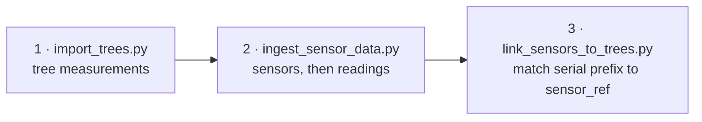

# Runbook — digital-twin-db

Bring the stack up, load data into it, query it, and recover it. For what the database is and
the variant model that shapes it, see [README.md](README.md).

---

## 1. Start the stack

`docker/.env` carries the passwords, JWT secrets and API keys. It is gitignored. Get the team's
copy from the password manager, or create your own from the template and generate every secret
(§9):

```bash
cp docker/.env.example docker/.env     # then replace every CHANGE_ME value
```

`.env.example` alone does not start a working stack: its keys are placeholders.

```bash
cd docker
docker compose up -d      # first run builds the db image and pulls the rest; later ~30 s
docker compose ps         # every service should read "healthy"
```

Run compose from `docker/` — there is no compose file at the repo root.

| Access point | URL |
|--------------|-----|
| Supabase Studio | <http://localhost:54323> — no login on this port; Kong's `:8000/` route asks for `DASHBOARD_USERNAME` / `DASHBOARD_PASSWORD` |
| REST API (Kong) | <http://localhost:8000/rest/v1> |
| PostgreSQL | `localhost:5432` — Supavisor pooler; user `postgres.<POOLER_TENANT_ID>` (e.g. `postgres.digital-forest-twin-local`), password `POSTGRES_PASSWORD` |

If a service shows `Exit` or `Restarting`:

```bash
docker compose logs <service-name>
```

Symptom-by-symptom: [docs/troubleshooting.md](docs/troubleshooting.md). Container stack
reference: [docs/docker/README.md](docs/docker/README.md).

---

## 2. Python environment

```bash
conda env create -f environment.yml     # from the repo root
conda activate digital-twin
```

`environment.yml` pulls `pylometree` from the University of Freiburg GitLab, which needs
university access. Outside the university, comment that line out and skip volume-calibration
features.

---

## 3. Load data

The database initialises with lookup tables but no forest data. Import in this order so foreign
keys resolve:



### Trees

```bash
python scripts/import/import_trees.py data/imports/ecosense_trees_import.csv    # 1,495 trees
python scripts/import/import_trees.py data/imports/mathisle_trees_import.csv    # 730 trees
python scripts/import/import_trees.py <csv> --dry-run                           # validate only
```

Preparing your own CSV — column mapping, coordinate transform, unit conversion, species
lookup, with worked Python and R examples:
[data/templates/DATA_PREPARATION_GUIDE.md](data/templates/DATA_PREPARATION_GUIDE.md).

### Sensors — any provider

Ingestion is provider-agnostic. `ingest_sensor_data.py` loads sensors and readings from any
CSV or JSON via the two source-agnostic bulk RPCs (`bulk_upsert_sensors`,
`bulk_insert_readings`). Both are **idempotent** — re-running the same export is always safe.
The file names below are placeholders for your own export.

```bash
python scripts/import/ingest_sensor_data.py sensors  <sensors.csv> --dry-run
python scripts/import/ingest_sensor_data.py sensors  <sensors.csv>
python scripts/import/ingest_sensor_data.py readings <readings.json>

# different column names in the source
python scripts/import/ingest_sensor_data.py sensors <vendor_export.csv> \
    --mapping <vendor_mapping.json>

python scripts/import/link_sensors_to_trees.py
```

A mapping file is a flat JSON object of `{"source_column": "rpc_field_name"}`.
`ingest_sensor_data.py --help` lists required fields, `position` vs `latitude`/`longitude`,
and the valid `quality` values.

The lab's own sensor data comes from two connector repos, each with its own README:
[aquarius-connector](https://gitlab.uni-freiburg.de/xr-future-forests-lab/aquarius-connector)
(talks to this database through the same two RPCs) and
[open-data-connector](https://gitlab.uni-freiburg.de/xr-future-forests-lab/open-data-connector)
(weather, climate, soil).

### Reference data

Lookups live as CSVs in `data/lookups/` and refresh without a rebuild:

```bash
python scripts/admin/refresh_lookups.py            # all tables
python scripts/admin/refresh_lookups.py species    # one table
python scripts/admin/refresh_lookups.py --list
```

> **A data fix needs both the migration and the CSV.** Correcting a value only in a migration
> means the next rebuild reverts it, because init reloads from CSV. Change both.

Table reference: [data/README.md](data/README.md). All scripts:
[scripts/README.md](scripts/README.md).

### Scenarios and growth variants

Scenarios are location-scoped and created per site by the seed scripts, not loaded from a
global CSV. Copy the pattern in `scripts/seed/ecosense_baseline_variant.sql`: it creates the
scenario and assigns baseline trees to `baseline_2025`. Growth variants on top are written by
`silva-connector`, chained via `parent_variant_id`.

`variant_types` (original, simulated_growth, repeat_measurement, …) load from
`data/lookups/variant_types.csv` on init.

Model and query patterns: [docs/variant-scenario-model.md](docs/variant-scenario-model.md).

---

## 4. Query it

### REST

```bash
export ANON_KEY=...    # from docker/.env

curl "http://localhost:8000/rest/v1/species" -H "apikey: $ANON_KEY"
curl "http://localhost:8000/rest/v1/ue_trees?variant_id=eq.2" -H "apikey: $ANON_KEY"
```

**Always filter on variant.** `trees.trees` holds measured trees alongside their SILVA
projections; an unfiltered query multiplies your stand.

Endpoint reference: [docs/api-spec.md](docs/api-spec.md). Query patterns per client:
[docs/data-access-guide.md](docs/data-access-guide.md).

### psql

`dftdb-db` publishes no host port, so admin work goes through the container:

```bash
docker exec -it dftdb-db psql -U postgres          # queries
docker exec -it dftdb-db psql -U supabase_admin    # DDL, seeds, dumps (owns the custom schemas)
```

```sql
\dn                          -- list schemas
\dt trees.*                  -- list tables in a schema
SELECT * FROM shared.species LIMIT 5;
```

For a file: `MSYS_NO_PATHCONV=1 docker exec -i dftdb-db psql -U supabase_admin -d postgres < file.sql`.

Host-side Python scripts connect through `scripts/utils/db.py` in the `digital-twin` conda
environment.

### Unreal

| Setting | Local | Server |
|---|---|---|
| API base URL | `http://localhost:8000/rest/v1` | `https://dt.unr.uni-freiburg.de/db/rest/v1` |
| `apikey` | `ANON_KEY` from `docker/.env` | the server's `ANON_KEY` |

The tree-placement endpoint is `/rest/v1/ue_trees` — a flat, pre-joined view carrying lat/lon,
species name, height, DBH and scenario in one query; filter it on `variant_id`. If you moved
Kong off 8000 (`KONG_HTTP_PORT`), change the base URL to match. Blueprint setup and PCG
integration are in the knowledge hub, `05-PRESENTATION-TIER/data-fetcher-guide`.

---

## 5. Triggering a connector run

Jobs are queued through a Postgres RPC on `/rest/v1/`, not an Edge Function. See
[docs/requesting-a-job.md](docs/requesting-a-job.md).

**This repo ships no custom Edge Functions and is not expected to.** The Deno runtime has no
conda, no R, no Blender and no PDAL, so it cannot execute the work this project runs; and Kong
routes `/functions/v1/` with only the `cors` plugin while `/rest/v1/` gets `key-auth` and
`acl`, so every function would hand-roll authentication that PostgREST provides for free.
`docker/volumes/functions/` holds only the platform's own `main/` router and `hello/` example.

---

## 6. Schema changes, reset and rebuild

### Applying a schema change

1. Add the migration under `supabase/migrations/` and mirror it into the next numbered file
   under `docker/volumes/db/init/` (workflow: [AGENTS.md](AGENTS.md#schema-migrations)).
2. Apply it to the running dev database as `supabase_admin`:

   ```bash
   docker exec -i dftdb-db psql -U supabase_admin -d postgres < supabase/migrations/<file>.sql
   docker exec dftdb-db psql -U supabase_admin -d postgres -c "NOTIFY pgrst, 'reload schema'"
   ```

3. Regenerate the schema docs and commit both files with the migration:

   ```bash
   python scripts/utils/generate_schema_docs.py           # writes docs/database-dictionary.md + docs/database-erd.dbml
   python scripts/utils/generate_schema_docs.py --check   # exit 1 if either is stale
   ```

**The `db` image bakes `docker/volumes/db/init/`.** A bare `up -d` reuses the old baked SQL;
after any schema change, rebuild the image before the next fresh init:

```bash
cd docker && docker compose build db && docker compose up -d db
```

### Full rebuild

`docker compose down -v` **deletes all data** (both named volumes). Back up first (§7).
`scripts/admin/reset_database.py` is not this procedure: it skips the image rebuild.

```bash
# 1. wipe volumes, rebuild the baked image, boot (init scripts run on first boot)
cd docker
docker compose down -v --remove-orphans
docker compose build db
docker compose up -d
cd ..

# 2. trees
python scripts/import/import_trees.py data/imports/ecosense_trees_import.csv
python scripts/import/import_trees.py data/imports/mathisle_trees_import.csv

# 3. seeds, all as supabase_admin (it owns the custom schemas)
docker exec -i dftdb-db psql -U supabase_admin -d postgres < scripts/seed/ecosense_baseline_variant.sql
docker exec -i dftdb-db psql -U supabase_admin -d postgres < scripts/seed/mathisle_baseline_variant.sql
# required after every ecosense import: import_trees.py writes stem_number = 1 only
docker exec -i dftdb-db psql -U supabase_admin -d postgres < scripts/seed/ecosense_zwisel_stem.sql
# 396 ecosense TLS canopy heights -> yield-table heights; before the derived-value fills
docker exec -i dftdb-db psql -U supabase_admin -d postgres < scripts/seed/ecosense_canopy_height_fix.sql
# optional: species-default roots and crown foliage profiles
docker exec -i dftdb-db psql -U supabase_admin -d postgres < scripts/seed/root_and_foliage_defaults.sql

# 4. derived values, in this order (each takes --dry-run)
python scripts/import/fill_missing_heights.py
python scripts/import/fill_missing_ages.py
python scripts/import/fill_missing_biomass.py

# 5. sensors and readings: run aquarius-connector and open-data-connector (see their READMEs),
#    then link sensors to trees
python scripts/import/link_sensors_to_trees.py
```

The Python importers connect as `postgres` for DML; that is fine. Growth variants come from
`silva-connector` afterwards.

**Missing tables after a fresh start** = the image was not rebuilt. **Studio or Kong not
reachable** = `analytics` is not healthy yet; `docker compose restart analytics`, wait ~15 s,
then `restart studio kong`. **Port already in use** = find the holder (`netstat -ano |
findstr :5432` / `ss -tlnp | grep 5432`) or change the mapping in `docker/.env`.
**Volumes fail after a Docker Desktop restart on Windows** = stale WSL bind-mount paths;
persistent state is on named volumes for exactly this reason, restart Docker Desktop and
`up -d`.

More: [docs/troubleshooting.md](docs/troubleshooting.md).

---

## 7. Operate

### Health

```bash
docker compose ps                                              # every service "healthy"
docker compose exec db pg_isready -U postgres
curl -s -o /dev/null -w "%{http_code}\n" http://localhost:8000/rest/v1/ -H "apikey: $ANON_KEY"   # 200
python scripts/utils/check_db_schema.py
python scripts/utils/generate_schema_docs.py --check          # schema docs match the database
```

### Logs

```bash
docker compose logs -f                                         # everything, live
docker compose logs --tail 500 db | grep -i error
docker compose logs --no-color > logs-$(date +%Y%m%d).log
docker stats
```

### Backup

Dump as `supabase_admin` — `postgres` is not a superuser and owns none of the custom objects.
This is the same dump the server's `dt-db-backup` timer writes nightly
(`scripts/server/backup-db.sh`, to `/media/data/dftdb/backups/dftdb_*.sql.gz`, 30 days kept):

```bash
docker exec dftdb-db pg_dump -U supabase_admin -d postgres \
    --exclude-table-data='sensor.sensor_readings' \
  | gzip > dftdb_$(date +%Y%m%d_%H%M%S).sql.gz
```

`sensor.sensor_readings` is dumped as structure only; its rows are re-fetched with
aquarius-connector after a restore.

### Restore

Restore into a scratch database, verify it, then take what you need from it. Do not restore
over the live database with `pg_restore --clean`; that path is not supported here.

```bash
# 1. empty scratch database, then load the dump (~50 s)
docker exec dftdb-db psql -U supabase_admin -d postgres -c "CREATE DATABASE restore_check"
gunzip -c dftdb_<stamp>.sql.gz | docker exec -i dftdb-db psql -U supabase_admin -d restore_check
```

Expect four errors `function graphql_public.graphql(...) does not exist`; they are harmless.

2. Verify: compare row counts of `trees.trees`, `trees.growth_simulations`, `shared.variants`,
   `sensor.sensors`, `auth.users` and `SELECT count(*) FROM pg_policies` between
   `restore_check` and `postgres`. `sensor.sensor_readings` is empty by design.
3. Copy the needed tables from `restore_check` into `postgres` (for example
   `pg_dump --data-only -t <schema.table>` piped into `psql`, after emptying the target), or
   point the stack at the restored database (`POSTGRES_DB` in `docker/.env`, then
   `up -d --force-recreate`; this variant was not part of the 2026-10-30 check).
4. Re-sync sensor readings with aquarius-connector, then
   `DROP DATABASE restore_check`.

Last verified on dev 2026-10-30: trees (180,225 rows), growth simulations, variants, sensors,
`auth.users` and the policy count matched the live database.

### Rotating credentials

The database password and API keys live in `docker/.env` here, but **three other places
hold copies**. Rotate the database first, then every consumer, then verify; there is no CI
and no secret store, so nothing else will tell you a consumer broke.

| # | Destination | Keys | Notes |
|---|---|---|---|
| 1 | `digital-twin-db/docker/.env` | `POSTGRES_PASSWORD`, `ANON_KEY`, `SERVICE_ROLE_KEY`, `JWT_SECRET` | Source of truth. Changing `JWT_SECRET` invalidates both API keys — regenerate them with `python scripts/utils/generate_jwt.py` |
| 2 | `aquarius-connector/.env` | `SERVICE_ROLE_KEY`, `SUPABASE_URL` | REST client; a stale key fails every sync |
| 3 | silva-connector | `PGPASSWORD` in the shell (or `docker/.env`) | libpq as `postgres`; see `silva-connector/docker/.env.example` |
| 4 | `digital-twin-dashboard/docker/.env` | `DB_PASSWORD`, `POOLER_TENANT_ID` | Through `dftdb-pooler`; the tenant id must match this stack's |

The portal and job page (`web/portal/config.js`, `web/jobs/config.js`) carry `ANON_KEY` too;
rewrite them after a `JWT_SECRET` change.

After step 1 recreate the stack — a `restart` is not enough, env is baked at container
creation:

```bash
cd docker && docker compose up -d --force-recreate
```

Verify: the API (`curl …/rest/v1/species?limit=1` → 200), `python -m
aquarius_connector.find_active_sensors` in aquarius-connector (read-only), a silva-connector
`--dry-run`, and `docker logs dtdash-shiny --tail 20` after recreating the dashboard.

### Emergency

```bash
cd docker && docker compose down && docker compose up -d      # full stack restart, keeps data
```

Rollback to the last backup: the restore recipe above.

---

## 8. Production

Deployment to `dt.unr.uni-freiburg.de` — TLS, Kong routing, NFS-backed `PGDATA`, and the
constraints that shaped them: [docs/deployment-guide.md](docs/deployment-guide.md).
Requesting jobs from there: [docs/requesting-a-job.md](docs/requesting-a-job.md).

Traps recorded there, because each cost days:

- **The API is served at `/db/` on 443** because a campus ACL blocks every other port; only
  `rest`, `auth` and `storage` are proxied — Studio is not, it needs an SSH tunnel.
- **Never name a compose service something campus DNS also resolves.** The service name
  `auth` resolved to a university web host, and Kong sent every `/auth/v1/` request off the
  machine for a week. A dev machine cannot reproduce this class of bug.
- **`nginx.conf` is a single-file bind mount**: a reload does nothing and `nginx -t` passes
  on the stale file — force-recreate the container.
- **The TLS certificate renews on `dt-renew-ssl.timer`**; verify it actually renewed before
  2026-12-01 rather than trusting a green timer (XRFF-421).
- **Signup is closed** (`DISABLE_SIGNUP=true`, XRFF-435); curators create accounts in the
  portal at `/portal/account/` ([docs/data-access-guide.md](docs/data-access-guide.md#user-management)).
  Mail does not leave the host, so passwords are handed over, not mailed.
- **The portal (`web/portal/`) is served by the dashboard's nginx** at `/portal/`, beside
  `/jobs/`, and `/` redirects there. Its `config.js` is written at deploy time, like the job
  page's — see [web/portal/README.md](web/portal/README.md).

---

## 9. Reference

### Environment variables (`docker/.env`, from `docker/.env.example`)

Secrets — change before any use:

| Variable | Generate with | Purpose |
|---|---|---|
| `POSTGRES_PASSWORD` | `openssl rand -base64 32` | PostgreSQL superuser |
| `JWT_SECRET` | `openssl rand -base64 32` | JWT signing secret |
| `ANON_KEY`, `SERVICE_ROLE_KEY` | `python scripts/utils/generate_jwt.py` | Supabase role JWTs |
| `DASHBOARD_PASSWORD` | `openssl rand -base64 32` | Studio login (via Kong) |
| `SECRET_KEY_BASE` | `openssl rand -base64 48` | Realtime / Supavisor session key (≥ 64 chars) |
| `VAULT_ENC_KEY` | `openssl rand -hex 16` | Supavisor vault key (32 hex) |
| `PG_META_CRYPTO_KEY` | `openssl rand -base64 32` | pg-meta |
| `LOGFLARE_PUBLIC_ACCESS_TOKEN`, `LOGFLARE_PRIVATE_ACCESS_TOKEN` | two different random strings ≥ 20 chars | Logflare |

Configuration (defaults from `.env.example`):

| Variable | Default | Notes |
|---|---|---|
| `POSTGRES_HOST`, `POSTGRES_DB`, `POSTGRES_PORT` | `db`, `postgres`, `5432` | `POSTGRES_PORT` is both the database's internal port and the pooler's host port (server: 5433) |
| `DASHBOARD_USERNAME` | `supabase` | |
| `KONG_HTTP_PORT`, `KONG_HTTPS_PORT` | `8000`, `8443` | server: 8001 |
| `POOLER_PROXY_PORT_TRANSACTION` | `6543` | |
| `POOLER_TENANT_ID` | `digital-forest-twin-local` | pooler username is `postgres.<POOLER_TENANT_ID>` |
| `POOLER_DEFAULT_POOL_SIZE`, `POOLER_MAX_CLIENT_CONN`, `POOLER_DB_POOL_SIZE` | `20`, `100`, `5` | |
| `PGRST_DB_SCHEMAS` | `public,storage,graphql_public,shared,pointclouds,trees,sensor,environments,imagery` | schemas PostgREST exposes |
| `SITE_URL`, `API_EXTERNAL_URL`, `SUPABASE_PUBLIC_URL` | `localhost` URLs | server: `https://dt.unr.uni-freiburg.de/db` |
| `DISABLE_SIGNUP` | `true` | accounts are created by curators (XRFF-435) |
| `PGDATA_PATH`, `STORAGE_PATH` | unset (named volume `db-data`, `./volumes/storage`) | server: `/media/data/dftdb/{pgdata,storage}` |
| `POSTGRES_SHARED_BUFFERS`, `POSTGRES_EFFECTIVE_CACHE_SIZE`, `POSTGRES_WORK_MEM` | unset (compose defaults `1GB`, `4GB`, `16MB`) | server: `2GB`, `8GB`, `16MB` |

Provider credentials (Aquarius, …) live in the connector repos, never here.

### Service start order (from `docker-compose.yml`)

```
vector → db → analytics → { studio, kong, auth, rest, realtime, meta, functions, supavisor }
imgproxy ─┐
rest ─────┴→ storage (also needs db)
mail (no dependencies)
```

If studio or kong will not start, check `analytics` first. Compose service names differ from
container names in two places: `functions` is `dftdb-edge-functions`, `supavisor` is
`dftdb-pooler`.

### Ports (dev)

| Service | Host | Container |
|---|---|---|
| Studio | 54323 | 3000 |
| Kong (REST, Auth, Storage) | 8000 / 8443 | 8000 / 8443 |
| Postgres via Supavisor (session) | 5432 | 5432 |
| Supavisor transaction pooler | 6543 | 6543 |
| Mail (inbucket, dev only — forwards nothing) | 2500 / 9000 / 1100 | 2500 / 9000 / 1100 |
| Analytics (Logflare) | 4000 | 4000 |

Realtime is not used. Its Kong route (`/realtime/v1/`) points at
`realtime-dev.supabase-realtime`, which does not resolve on dev.

On the server Kong is on **8001** and Postgres on **5433**; the public surface is 443 only.
