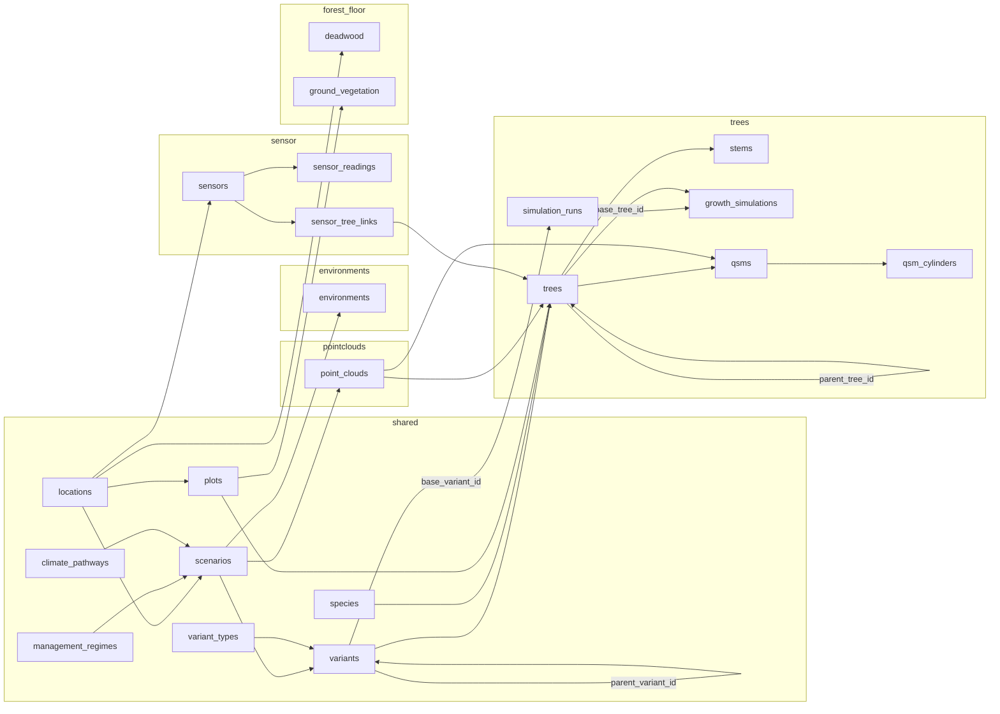
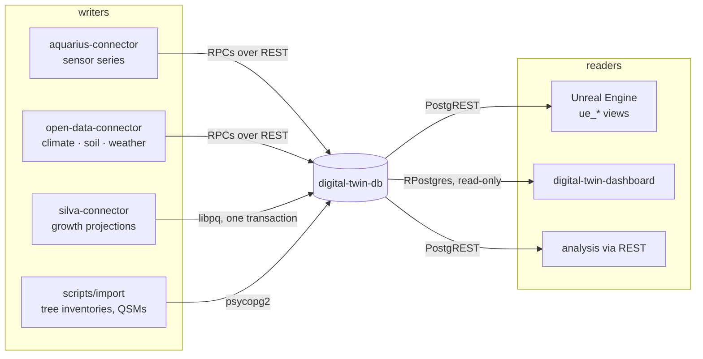

# Database Overview

How the schemas fit together and how to query them. Every column, type and constraint is in the
generated [database-dictionary.md](database-dictionary.md); the location → scenario → variant
model in detail is in [variant-scenario-model.md](variant-scenario-model.md). Background on the
design choices is in the knowledge hub, `03-DATA-TIER/digital-twin-database`.

**Last Updated:** 2026-10-30

---

## The seven schemas

72 base tables across seven domain schemas, plus `public`, which holds the REST API: one view
per table that the API exposes, the `ue_*` views for Unreal Engine, and the RPC functions.

| Schema | Tables | Holds |
|---|---:|---|
| `shared` | 31 | Locations, plots, scenarios (`management_regimes` × `climate_pathways`), `variants`, `variant_types`, species, campaigns, management and disturbance events, processes and their parameters, `attribute_provenance`, `processing_jobs`, `audit_log` and its junction tables, `account_events`, `lookup_registry`, soil and climate lookups |
| `trees` | 29 | `trees` (one row per tree per variant), `stems`, `phenology_observations`, `growth_simulations` + `simulation_runs` (SILVA output), `qsms` + `qsm_cylinders`, `tree_part_types`, `tree_graph_edges`, `roots` + `root_system_types`, `crown_foliage_profiles`, `tree_status`, `data_source_types`, morphology and crown classification lookups |
| `sensor` | 5 | `sensors`, `sensor_readings`, `sensor_types`, `units`, `sensor_tree_links` |
| `environments` | 1 | `environments`: climate and soil values per location, scenario and period |
| `pointclouds` | 3 | `point_clouds` (file references and processing lineage), `scanners`, `scanner_types` |
| `imagery` | 1 | `images` with position and camera orientation |
| `forest_floor` | 2 | `deadwood`, `ground_vegetation`: plot-level surveys, not tied to one tree |

All names are lowercase snake_case. Tables and columns carry `COMMENT ON` descriptions, which
the dictionary reproduces.

---

## Core relationships

The tables most queries touch, with their foreign keys. Lookups, audit and process tables are
left out; the dictionary lists every foreign key.



`environments`, `point_clouds` and `sensor_readings` reference a scenario but not a variant: they
carry `scenario_id`, and `environments` and `point_clouds` also carry `variant_type_id` and a
free-text `variant_name`. Only `trees.trees` has a `variant_id`.

---

## Key patterns

### Location → scenario → variant

A **location** (`ecosense`, `mathisle`) owns its **scenarios**. A scenario is one point on two
axes: a `management_regime_id` (`none`, `natural_growth`, `crop_tree_thinning`,
`target_diameter_harvest`) and a `climate_pathway_id` (`historical`, `ssp126`, `ssp370`,
`ssp585`), with the generated `scenario_code = management_regime_id * 10 + climate_pathway_id`.
Regime `none` scenarios (`ssp126` …) hold acquired climate data only, never trees.

A scenario owns a chain of **variants** (`shared.variants`), one per forest state:
`baseline_2025` → `silva_2030` → `silva_2035` …, linked by `parent_variant_id` and ordered by
`sort_order`. The measured `baseline_2025` exists only in `natural_growth`; the first variant of
every other projection chain points across scenarios at it. `variant_type_id` (`original`,
`simulated_growth`, …) says how the state was produced.

`trees.trees` holds one row per tree per variant, so **every query against `trees.trees` must
filter on `variant_id`** (or on variant and scenario names); otherwise it mixes the measured
forest with its projections. Details and the UE query sequence:
[variant-scenario-model.md](variant-scenario-model.md).

### Persistent tree identity

`tree_id` identifies one row, meaning one tree in one variant. `tree_entity_id` (UUID) identifies the physical
tree across all its variants, and also keys its rows in `trees.growth_simulations` and
`trees.qsms`. `parent_tree_id` points at the row a projected row was grown from.

### Audit trail

An `AFTER UPDATE` trigger (`shared.audit_update_trigger`) writes one `shared.audit_log` row per
changed field (`field_name`, `old_value`, `new_value`, `user_id`, `timestamp`, `ip_address`) on
five tables: `trees.trees`, `trees.stems`, `trees.phenology_observations`,
`environments.environments` and `pointclouds.point_clouds`. Junction tables
`shared.audit_log_trees`, `audit_log_stems`, `audit_log_phenology_observations`,
`audit_log_environments` and `audit_log_point_clouds` tie each entry to its row. Inserts and
deletes are not audited. The main data tables also carry `created_by` / `updated_by` columns,
set by triggers.

Correct a wrong value with a plain `UPDATE`; create a new variant only for a new forest state.

### Provenance

- `trees.trees.data_source_type_id` records how a tree record was produced (`field`, `lidar`,
  `photogrammetry`, `estimated`, `simulated`); `height_source` records how `height_m` in
  particular was arrived at; `process_id` points at the `shared.processes` row for the run.
- `shared.process_parameters` and its junction tables record the parameters a process used for a
  tree, stem, point cloud or environment row; `trees.simulation_runs.run_params` does the same
  for a SILVA run.
- `shared.attribute_provenance` records the source of each acquired `shared.locations` attribute.

See [derived-value-provenance.md](derived-value-provenance.md) and
[run-provenance.md](run-provenance.md).

### Spatial data

Positions are PostGIS geometries in WGS84 (`position`, EPSG:4326). Where the source CRS
differs, the original geometry is kept in `position_original` with its EPSG code in
`source_crs`; each location declares its projected CRS in `shared.locations.crs_epsg` (EPSG:32632
for both sites). `ue_trees` exposes flat `latitude` / `longitude` and projected `original_x` /
`original_y`, so clients need no geometry parsing.

### Row-level security

65 of the 72 tables have RLS enabled. Anonymous requests and accounts without a role tier can
only read; writes depend on the account's role tier and go through the `public` views and RPCs.
Accounts and role tiers: [data-access-guide.md](data-access-guide.md#user-management).

---

## Data flow



The connector RPCs (`bulk_upsert_sensors`, `bulk_insert_readings`, `upsert_environment`,
`set_location_attributes`, `refresh_soil_aggregates`) are executable by `service_role` only.
silva-connector and the dashboard read the base tables directly; see the "Consumers that read
base tables directly" section of [AGENTS.md](../AGENTS.md). Connector runs are queued through
`shared.processing_jobs` and the `request_job()` RPC: [requesting-a-job.md](requesting-a-job.md).

---

## Access patterns

| Endpoint | Local | Production (dt.unr) |
|---|---|---|
| REST | `http://localhost:8000/rest/v1` | `https://dt.unr.uni-freiburg.de/db/rest/v1` |
| Auth | `http://localhost:8000/auth/v1` | `https://dt.unr.uni-freiburg.de/db/auth/v1` |

Send the anon key (or a user's JWT) as `apikey` and `Authorization: Bearer` headers. Look ids up
by name: locations are currently `1` = ecosense and `2` = mathisle, but scenario and variant ids
differ between databases.

### REST

```bash
# Locations
GET /rest/v1/locations?select=location_id,location_name

# Scenarios at a site that hold trees, in scenario_code order
GET /rest/v1/ue_scenarios?location_name=eq.ecosense&has_trees=eq.true&order=scenario_code

# The variants (time steps) of one scenario
GET /rest/v1/ue_variants?scenario_id=eq.<scenario_id>&order=sort_order

# All trees of one forest state, flat
GET /rest/v1/ue_trees?variant_id=eq.<variant_id>

# The same state by name
GET /rest/v1/ue_trees?location_name=eq.ecosense&scenario_name=eq.natural_growth&variant_name=eq.silva_2035

# Trees with species and stems embedded
GET /rest/v1/trees?variant_id=eq.<variant_id>&select=tree_id,height_m,species(common_name),stems(dbh_cm)
```

Endpoints, views and RPC signatures: [api-spec.md](api-spec.md). Client-specific patterns (R,
Python, Unreal): [data-access-guide.md](data-access-guide.md).

### SQL

```sql
-- One forest state with species and main-stem DBH, selected by name
SELECT t.tree_id, t.tree_entity_id, sp.common_name, t.height_m, s.dbh_cm
FROM trees.trees t
JOIN shared.variants  v  ON v.variant_id   = t.variant_id
JOIN shared.scenarios sc ON sc.scenario_id = v.scenario_id
JOIN shared.locations l  ON l.location_id  = v.location_id
LEFT JOIN shared.species sp ON sp.species_id = t.species_id
LEFT JOIN trees.stems    s  ON s.tree_id = t.tree_id AND s.stem_number = 1
WHERE l.location_name  = 'ecosense'
  AND sc.scenario_name = 'natural_growth'
  AND v.variant_name   = 'baseline_2025';

-- One physical tree through time in one scenario
SELECT v.simulation_year, t.height_m
FROM trees.trees t
JOIN shared.variants  v  ON v.variant_id   = t.variant_id
JOIN shared.scenarios sc ON sc.scenario_id = v.scenario_id
WHERE t.tree_entity_id = '<uuid>'
  AND sc.scenario_name = 'natural_growth'
ORDER BY v.simulation_year;

-- Trees within 25 m of a point, in one forest state
SELECT t.tree_id
FROM trees.trees t
WHERE t.variant_id = <variant_id>
  AND ST_DWithin(t.position::geography,
                 ST_SetSRID(ST_MakePoint(7.8781, 48.2686), 4326)::geography, 25);

-- Daily means of tree-linked sensors for one week
SELECT stl.tree_id, st.sensor_type_name, se.unit,
       date_trunc('day', sr.timestamp) AS day, avg(sr.value) AS mean_value
FROM sensor.sensor_readings sr
JOIN sensor.sensor_tree_links stl ON stl.sensor_id = sr.sensor_id
JOIN sensor.sensors se            ON se.sensor_id  = sr.sensor_id
JOIN sensor.sensor_types st       ON st.sensor_type_id = se.sensor_type_id
WHERE sr.timestamp >= '2025-07-01' AND sr.timestamp < '2025-07-08'
GROUP BY 1, 2, 3, 4
ORDER BY 1, 2, 4;
```

Sensors are linked to the measured baseline tree rows, so `sensor_tree_links.tree_id` points at
`baseline_2025` rows. Use `tree_entity_id` to carry a link to a projected variant.

---

## Further reading

| Need | Read |
|---|---|
| Every table, column, type, constraint and DB comment (generated) | [database-dictionary.md](database-dictionary.md) |
| ERD (generated) | [database-erd.dbml](database-erd.dbml) |
| Variant model and UE query sequence | [variant-scenario-model.md](variant-scenario-model.md) |
| SILVA output tables | [growth-simulation-schema.md](growth-simulation-schema.md), [silva-coupling.md](silva-coupling.md) |
| QSM and CityGML column mapping | [citygml-qsm-mapping.md](citygml-qsm-mapping.md) |
