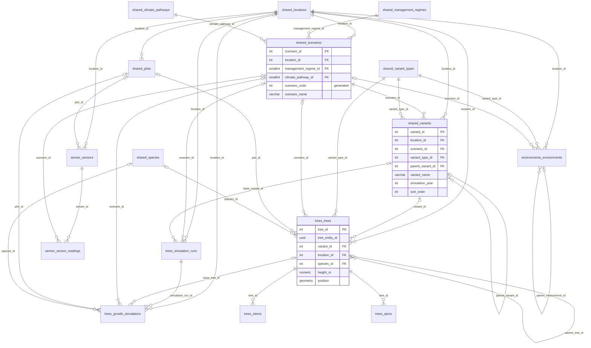

# Database Schema: Forest Digital Twin Database

**Document Version:** 2.0
**Date:** 2026-10-30
**Status:** Active


## Quick Navigation

- [Docs Hub](README.md)
- [Architecture](database-overview.md)
- [API Spec](api-spec.md)
- [Deployment Guide](deployment-guide.md)
- [Existing DB Overview](database-overview.md)
- [Data Dictionary (generated)](database-dictionary.md)
- [Complete ERD (DBML, generated)](database-erd.dbml)

## Agent Entry

| Signal | Value |
|--------|-------|
| Purpose | How the schemas fit together, the core relationships, conventions and the notes a column list cannot carry. |
| Read When | You need the shape of the database, what a column or lookup means, or the naming rules. |
| Skip When | You need a column's exact type, nullability, default or constraint: read [database-dictionary.md](database-dictionary.md). You only need API contracts or operational commands. |
| Canonical | Yes, for conventions and semantics. Column-level facts are canonical in [database-dictionary.md](database-dictionary.md). |
| Next Docs | [Data Dictionary](database-dictionary.md), [Architecture](database-overview.md), [API Spec](api-spec.md) |
| Primary Sources | `supabase/migrations/`, the live database (via `scripts/utils/generate_schema_docs.py`) |

---

## 1. Introduction

### 1.1 Purpose

This document describes the schema organisation, core entity relationships, conventions and column semantics of the Forest Digital Twin Database. The database stores field measurements, LiDAR scan data, sensor time-series, environmental conditions, growth simulations, tree structure models and imagery for forest plot management and VR digital twin generation.

Every table's columns, types, nullability, defaults, foreign keys (with `ON DELETE`), constraints and stored comments are in [database-dictionary.md](database-dictionary.md); the complete ERD is [database-erd.dbml](database-erd.dbml). Both are generated from the live database by `scripts/utils/generate_schema_docs.py` and are not edited by hand.

### 1.2 Database System

**PostgreSQL 15** with **PostGIS 3** (installed in the `extensions` schema, so the type is `extensions.geometry`). All stored spatial columns use WGS84 (EPSG:4326), except the local-frame QSM geometry (§3.6). The deployment runs via Docker — see `docker/docker-compose.yml`.

### 1.3 Schema Organization

**Seven domain schemas** holding **72 tables**, plus `public` (PostgREST-facing views):

| Schema | Tables | Purpose | Main tables |
|--------|-------:|---------|-------------|
| `shared` | 31 | Reference and cross-domain data | locations, plots, scenarios, management_regimes, climate_pathways, variants, variant_types, species, campaigns, processes, processing_jobs, attribute_provenance, audit_log, account_events, management_events, disturbance_events |
| `trees` | 29 | Tree measurements per forest state, simulator output, tree structure | trees, stems, phenology_observations, simulation_runs, growth_simulations, qsms, qsm_cylinders, tree_graph_edges, roots, crown_foliage_profiles, morphology lookups |
| `sensor` | 5 | Environmental sensor hardware and time-series | sensor_types, sensors, sensor_readings, sensor_tree_links, units |
| `environments` | 1 | Climate and soil per location, scenario and period | environments |
| `pointclouds` | 3 | LiDAR scan data and processing lineage | point_clouds, scanner_types, scanners |
| `imagery` | 1 | Aerial and ground-based images | images |
| `forest_floor` | 2 | Plot/site-level surveys, not tied to a single tree | deadwood, ground_vegetation |
| `public` | — | PostgREST API views over the schemas above | Views only — no data |

Eight further views live inside the domain schemas (e.g. `shared.recent_changes`, `trees.trees_with_metrics`); they are listed in the dictionary.

### 1.4 Normalization

Third Normal Form (3NF) throughout. JSONB is used selectively for semi-structured payloads: `external_metadata` on `sensor.sensors`, `input_data`/`output_data` on `shared.processing_jobs`, `param_schema` on `shared.processes`, `run_params` on `trees.simulation_runs`, `silva_rules` on `shared.management_regimes`. All spatial data uses PostGIS geometry columns rather than separate lat/lon columns.

---

## 2. Core Entity Relationship Diagram

The core of the model: site → scenario → forest state (variant) → trees, with the sensor, environment, simulation and QSM branches. Every edge is a real foreign key, labelled with the FK column. `||` on the parent side means the FK is NOT NULL; `o|` means it is nullable (the child may exist without that parent). Entity names are `schema_table`. The complete ERD (all 72 tables) is [database-erd.dbml](database-erd.dbml).



---

## 3. Column Semantics and Notes

Columns, types, nullability, defaults, FKs, constraints and stored comments: **[database-dictionary.md](database-dictionary.md)** (anchors are `#schematable`, e.g. [`#sharedlocations`](database-dictionary.md#sharedlocations)). This section keeps only what a column list does not say.

### 3.1 `shared.locations`

Central reference table — almost all domain data links back to a location.

| Column | Note |
|--------|------|
| `forest_growth_region` | German `Wuchsgebiet.Wuchsbezirk` code, e.g. `99.73.13`. Keys silvaR's climate table |
| `soil_moistness` | SILVA soil moisture class 1–9 (1 = very dry, 5 = fresh, 9 = very wet) |
| `soil_nutrient_supply` | SILVA nutrient supply class 1–5 (1 = very low, 5 = very high) |
| `crs_epsg` | Declared internal projected CRS of the site (both sites 32632 = WGS 84 / UTM 32N). Geometry columns stay EPSG:4326; this is the frame consumers transform into for metric work. Seeded from `data/lookups/locations.csv`, not settable via `set_location_attributes` |
| `soil_type_id` / `climate_zone_id` | USDA soil order / Köppen climate zone |

**Writing site attributes:** `elevation_m`, `slope_deg`, `aspect`, `soil_type_id`, `climate_zone_id`, `forest_growth_region`, `soil_moistness` and `soil_nutrient_supply` are written by the `public.set_location_attributes` RPC, which records a `shared.attribute_provenance` row for each in the same transaction. Those eight are the complete set it accepts; it raises on any other key. EXECUTE is granted to `service_role` only (migration `20261030120000`). See [api-spec.md §3.4](api-spec.md).

### 3.2 `shared.scenarios`, `shared.variants` and their lookups

A **scenario** is one combination of a location × a management regime × a climate pathway: UNIQUE `(location_id, management_regime_id, climate_pathway_id)` and UNIQUE `(location_id, scenario_name)`. `scenario_code` is a generated column, `management_regime_id * 10 + climate_pathway_id`.

| `shared.management_regimes` | | `shared.climate_pathways` | | |
|---|---|---|---|---|
| **id** | **name** | **id** | **name** | **label** |
| 0 | none | 0 | historical | historical |
| 1 | natural_growth | 1 | ssp126 | SSP1-2.6 |
| 2 | crop_tree_thinning | 2 | ssp370 | SSP3-7.0 |
| 3 | target_diameter_harvest | 3 | ssp585 | SSP5-8.5 |

`management_regimes.silva_rules` holds the regime's SILVA treatment parameters. Values are as of 2026-10-30; the tables are the source.

A **variant** (`shared.variants`) is one complete forest state within a scenario: all `trees.trees` rows with the same `variant_id` form it. `parent_variant_id` chains states (baseline → growth → …; NULL for the baseline), `simulation_year` is the calendar year the state represents, `time_delta_yrs` the years since the scenario baseline, `sort_order` the display order for the UE time slider (0 = baseline). `variant_name` is unique per `(location_id, scenario_id)`. See [variant-scenario-model.md](variant-scenario-model.md).

**`shared.variant_types`** values: `original`, `processed`, `manual`, `simulated_growth`, `user_input`, `sensor_derived`, `model_output`, `repeat_measurement`.

### 3.3 `shared.species`

| Column | Note |
|--------|------|
| `leaf_type` | `needleleaf` / `broadleaf`, independent of `is_deciduous` (larch: deciduous and needleleaf). Set by migration `20261008120000`, not by the CSV |
| `gbif_key`, `gbif_accepted_name` | GBIF taxon validation (`scripts/admin/`) |

**Lookup data source:** `data/lookups/species.csv`

### 3.4 `shared.campaigns`

Data collection campaigns grouping related field work. `campaign_type`: `lidar_flight`, `field_inventory`, `sensor_deployment`, `drone_survey`, `manual_update`.

### 3.5 `trees.trees` and its lookups

Each row is one physical-tree record within one forest state (variant).

| Column | Note |
|--------|------|
| `tree_entity_id` | Stable identity of the physical tree across all rows, variants and scenarios. Defaults to `gen_random_uuid()`; the column is nullable |
| `variant_id` | Forest state this row belongs to (§3.2) |
| `scenario_id` | Convenience FK, resynced from the variant |
| `data_source_type_id` | How the record as a whole was produced → `trees.data_source_types`: `field`, `lidar`, `photogrammetry`, `estimated`, `simulated` |
| `height_source` | How `height_m` was arrived at; NULL means unrecorded. Deliberately unconstrained (§7.2); values in use are listed in the column comment (`measured`, `allometric_pylometree`, `simulated_silva`) |
| `live_crown_ratio` | Generated: `(height_m - crown_base_height_m) / height_m` |
| `sensor_ref` | Source-agnostic reference to the sensor cluster on this tree; matches the prefix of `sensor.sensors.serial_number` so all of a tree's sensors resolve from it (for current Ecosense data e.g. `Beech_Mixed_8`). NULL if not instrumented. See §3.10 |
| `tree_number` | Local tree number within location/plot (field inventory numbering) |
| `crown_class_id` | Crown social position — FIA `CCLCD` / NEON `canopyPosition` analog |
| `damage_agent_id` | Primary agent of observed damage or decline — FIA `AGENTCD` analog |
| `defoliation_percent`, `discolouration_percent`, `crown_transparency_percent` | ICP Forests-style crown assessments |

**Key computed functions:** `trees.calculate_basal_area(dbh_cm)`, `trees.calculate_crown_volume(crown_width_m, crown_height_m)`

**Lookup values** (read-only reference tables; data source `data/lookups/<table>.csv`):

| Table | Values |
|-------|--------|
| `trees.tree_status` | healthy, stressed, declining, dead, harvested, missing, downed, broken |
| `trees.crown_classes` | dominant, co_dominant, intermediate, overtopped, open_grown |
| `trees.damage_agents` | none, insect, disease, fire, wind, snow_ice, drought, mechanical, animal, human_activity, competition, unknown |
| `trees.data_source_types` | field, lidar, photogrammetry, estimated, simulated |

The morphology lookups (`axis_structures`, `bark_characteristics`, `branch_elongation_habits`, `branching_patterns`, `crown_architectures`, `crown_shapes`, `geometric_crown_solids`, `growth_forms`, `growth_orientations`, `phanerophyte_height_classes`, `shoot_elongation_types`, `straightness_types`, `taper_types`) are listed with their columns in the dictionary; their values are in the CSVs.

**`trees.stems`:** one row per stem of a multi-stem tree; `stem_number = 1` is the main stem. `dbh_cm` is measured at 1.3 m.

### 3.6 QSM tables: `trees.qsms`, `trees.qsm_cylinders`, `trees.tree_part_types`, `trees.tree_graph_edges`

QSM (Quantitative Structure Model) reconstructions and their cylinder geometry, aligned with CityGML (see [citygml-qsm-mapping.md](citygml-qsm-mapping.md)). `trees.qsms` is variant-like: the same physical tree (`tree_entity_id`) can have several reconstructions from different scans, tools or parameter sets. QSM-derived volume/DBH/height/crown area are kept separate from `trees.trees`' allometric values (`dbh_qsm_cm` validates against `trees.stems.dbh_cm`). `is_corrected`: raw TreeQSM (false) vs Real Twig radius-corrected (true). `lod`: CityGML LoD the reconstruction supports.

`trees.qsm_cylinders` (~10³–10⁴ rows per tree) uses the Real Twig / rTwig standardised cylinder column set ([rTwig "Dictionary" vignette](https://aidanmorales.github.io/rTwig)), source geometry/topology columns only:

| Column | Note |
|--------|------|
| `cylinder_index` | Cylinder id within the QSM, as published (rTwig `id`), 1-based |
| `parent_cylinder_index` | Not an FK — self-reference by index, as in the source files; 0 = base cylinder |
| `start_point` | `geometry(PointZ)` in the QSM's local frame (no SRID); `trees.qsms.local_crs` names the frame, `origin_position` georeferences it |
| `axis` | Unit vector base → top, `double precision[3]` |
| `length_m` | 0 is allowed: TreeQSM output contains zero-length cylinders that others hang off |
| `radius_m` / `raw_radius_m` | Radius as delivered (corrected where the source corrects) / fit before correction (rTwig `raw_radius`, TreeQSM `UnmodRadius`), NULL when the source does not keep it |
| `is_virtual` | Cylinder added to bridge a gap in the cloud (TreeQSM `added`, TreeML `addedVirtual`) |
| `branch_index`, `branch_order`, `branch_position` | Axis id from 1, axis order (0 = trunk), position along the axis from 1 — by the lab's single axis rule (the child with the longer supported subtree continues the axis), not the producing tool's ids |

`raw_radius_m`, `is_virtual` and the zero-length allowance came with migration `20261006120000`. tree-structure's `tree-structure-standardize` writes this table's convention, so one tree's rows of its `cylinders.csv.gz` (without the `tree_uid` column) are what `scripts/import/import_qsm.py` reads.

`trees.qsm_cylinders` has no `public.*` view (`trees.qsms` does); it is reachable via the `trees` schema in `PGRST_DB_SCHEMAS`, under the same RLS policies.

**`trees.tree_part_types`:** root, trunk, branch, twig, leaf, crown (CityGML feature classes). Only trunk/branch/twig are assigned to cylinders, by `import_qsm.py --twig-radius-mm` (not a stored rule):

1. `branch_order = 0` → `trunk`
2. `branch_order >= 1 AND radius_m <= twig_radius_m` → `twig`
3. `branch_order >= 1 AND radius_m > twig_radius_m` → `branch`

`twig_radius_m` is the species value from rTwig's `twigs`/`twigs_index` reference database — the same value used to correct that QSM's radii.

**`trees.tree_graph_edges`:** stores only edges whose type deviates from the default; the full edge set is already `qsm_cylinders.parent_cylinder_index`. `edge_type`:

| Value | Meaning |
|-------|---------|
| `observed` | The source measured the connection directly (implicit default for any edge with no row) |
| `synthetic` | The source itself flagged the connection as inferred |
| `derived` | We added or overrode the edge (import cleanup, topology fixes) |

**Lookup data source:** `data/lookups/tree_part_types.csv`

### 3.7 `trees.roots` and `trees.crown_foliage_profiles`

**`trees.roots`:** root system classification now, geometry later (Guerrero Iñiguez 2017 detail levels). `root_system_type_id` → `trees.root_system_types`: `tap_root`, `heart_root`, `lateral_root` (Köstler et al. 1968). `source`: `species_default` | `field_observed` | `measured`. `geometry_class`: `implicit` (block model, LoD1–3) | `explicit` (surface-projected, LoD4); a matching column on a future tree-asset table is planned, not built. `root_depth_m` and `root_spread_radius_m` stay NULL until measured.

`scripts/seed/root_and_foliage_defaults.sql` seeds one `species_default` row per tree of 11 species:

| Root system | Species |
|-------------|---------|
| tap_root | *Quercus robur, Abies alba, Pinus sylvestris, Pseudotsuga menziesii* |
| heart_root | *Fagus sylvatica, Acer pseudoplatanus, Fraxinus excelsior, Tilia cordata* |
| lateral_root | *Picea abies, Prunus avium, Betula pendula* |

**`trees.crown_foliage_profiles`:** crown leaf area density/distribution, not per-leaf geometry. `distribution_type`: `beta` | `johnson_sb` | `uniform` (`uniform` = no species-specific shape known yet; `vertical_params`/`horizontal_params` NULL). `source`: `species_literature_default` | `fitted` | `measured`. `shared.processes` holds rows for Le Port et al. (2000, Beta PDFs, doi:10.1051/forest:2000110) and Jeréz et al. (2005, Johnson SB, doi:10.1093/forestscience/51.2.93). The seed script's rows for the same trees are `uniform` with no `process_id`: neither paper covers these species.

**Lookup data source:** `data/lookups/root_system_types.csv`

### 3.8 `pointclouds.point_clouds`

Original scans and processed derivatives share the table, linked via `parent_point_cloud_id`. File content is in S3; `file_path` must match `^s3://<bucket>/….(las|laz|ply)$`. `processing_status` is NULL for original scans. `variant_name` is required.

**S3 helper functions:** `pointclouds.get_s3_bucket(file_path)`, `pointclouds.get_s3_key(file_path)`, `pointclouds.validate_s3_uri(file_path)`

### 3.9 `sensor.sensors` and `sensor.units`

Source-agnostic: Aquarius is one of several possible providers.

| Column | Note |
|--------|------|
| `source` | External provider, e.g. `aquarius`. Deliberately unconstrained (§7.2) |
| `external_id` | Identifier within the source system; UNIQUE, the upsert key of `bulk_upsert_sensors` |
| `external_metadata` | Raw source payload: `Label`, `Parameter`, `LocationIdentifier`, `native_interval_seconds` (the logger's own cadence where it differs from the stored one), and after enrichment `Instrument`, `DataOwner`, `TypeOfMeasurement`, `GapTolerance` |
| `sampling_interval_seconds` | Cadence of the **stored** readings: 900 for the 15-min network, 3600 for the weather station and for fast series thinned to hourly on ingest. Set by the connector from the observed points; `sensor.check_sensor_health` divides by it |
| `unit` | Natural-key FK → `sensor.units.unit_name` (as is `sensor_types.typical_unit`); `sensor.units` is the unit vocabulary with a display form per unit |

**Metadata enrichment.** `sensor_model` defaults to a generic `Ecosense Node` from the API sync. The [aquarius-connector](https://gitlab.uni-freiburg.de/xr-future-forests-lab/aquarius-connector) repo's `enrich_metadata.py` matches an Aquarius *Insitu DataUpload* `.xlsx` export by `external_id` and backfills the real instrument model (e.g. `SMT100`, `Implexx Sap Flow Sensor`, `FloraPulse_Tensiometer`) into `sensor_model`, plus `DataOwner` / `TypeOfMeasurement` / `GapTolerance` into `external_metadata`, via the `bulk_upsert_sensors` RPC (EXECUTE for `service_role` only). Re-run it **after** every Aquarius sync — the sync upsert resets these fields.

### 3.10 `sensor.sensor_readings`

High-volume time series. The unique index on `(sensor_id, timestamp)` serves every per-sensor query (read backwards for `ORDER BY timestamp DESC`) and makes `bulk_insert_readings` (EXECUTE for `service_role` only) idempotent. Series sampling faster than every 15 minutes are stored at one reading per hour — the raw point nearest each hour boundary, timestamp as measured, not a mean — by the ingesting connector and, for rows loaded before 2026-09-16, by init file `44-thin-fast-series-to-hourly.sql`; the rule is spelled out there and in `aquarius_connector.sync.nearest_hour_samples`, and the two must agree. `scenario_id` is NULL for real readings.

**Indexes:** UNIQUE `(sensor_id, timestamp)`, `(timestamp DESC)`, `(quality)`, `(scenario_id)`. The former `(sensor_id, timestamp DESC)` and `(sensor_id)` indexes duplicated the unique key and were dropped 2026-09-16.

**Helper functions:** `sensor.get_latest_reading(sensor_id)`, `sensor.aggregate_readings(sensor_id, start_time, end_time, interval_minutes)`, `sensor.check_sensor_health(sensor_id, hours_back)`

### 3.11 `sensor.sensor_tree_links` — sensor ↔ tree

Links each Ecosense sensor to the inventory tree its monitoring cluster is installed on; UNIQUE `(sensor_id, tree_id)`. Exposed via `public.sensor_tree_links` and consumed by `public.ue_sensors` (`tree_id`, `tree_entity_id` and the `linked_tree_*` fields).

**How links are created.** Aquarius names each sensor time-series with a per-species, per-plot-type sequence number (e.g. `Beech_Mixed_8`) that is *independent* of the inventory tree numbering (`plot_id` × `tree_number`), and Aquarius does not carry the inventory ID. The field-surveyed map `data/reference/ecosense_sensor_tree_map.csv` bridges the two. `scripts/import/link_sensors_to_trees.py`:

1. Backfills `trees.trees.sensor_ref` (resolved by `plot_id` + `tree_number`).
2. Links every sensor whose `serial_number` prefix equals a tree's `sensor_ref` — the whole monitoring cluster (dendrometer, sap flow, stem water potential, and the surrounding soil moisture / soil temperature probes).

Run after tree and sensor data are imported; idempotent (`ON CONFLICT DO NOTHING`). `sensor.link_sensors_to_trees_by_pattern()` is deprecated — it guessed the tree from the label number, which is ambiguous across plots.

### 3.12 `environments.environments`

Environmental condition rows — aggregated from sensor data, fetched from open data, or defined for simulation scenarios. `scenario_id` NULL = non-scenario row; `end_date` NULL = ongoing; `process_id` names what produced the row (dataset, version, aggregation method, citation, licence).

**Natural key:** unique index `uq_environments_natural_key` on `(location_id, scenario_id, variant_type_id, variant_name, start_date, end_date)` `NULLS NOT DISTINCT`, so repeated refreshes of a row with NULL scenario or period bounds do not insert duplicates. Use a deterministic `variant_name` (e.g. `cmip6_ssp245_2041_2070`). It is the conflict target of `public.upsert_environment`.

**Writing rows:** `public.upsert_environment` (EXECUTE for `service_role` only; see [api-spec.md §3.4](api-spec.md)) creates or refreshes one row per natural key and requires a `process_id`. It **merges**: a measurement key absent from its payload leaves the stored value alone, so two sources can populate different columns of the same period — and it cannot set a value back to `NULL`.

**Helper functions:** `environments.calculate_duration_days(start, end)`, `environments.is_active(start, end)`, `environments.create_from_sensor_data(location_id, start_time, end_time)`

### 3.13 `shared.audit_log` and junction tables

Field-level change tracking: one row per changed field, linked to the entity through a junction table. `old_value`/`new_value` are JSON text. Rows are written by `shared.audit_update_trigger()`, an AFTER UPDATE trigger on the five audited tables:

| Audited table | Junction table |
|---------------|----------------|
| `trees.trees` | `shared.audit_log_trees` |
| `trees.stems` | `shared.audit_log_stems` |
| `trees.phenology_observations` | `shared.audit_log_phenology_observations` |
| `pointclouds.point_clouds` | `shared.audit_log_point_clouds` |
| `environments.environments` | `shared.audit_log_environments` |

Point-cloud and phenology updates went unlogged from the 2026-09-23 renames until migration `20261030120000`. Inserts and deletes are not audited by the trigger.

### 3.14 `trees.growth_simulations` and `trees.simulation_runs`

**`trees.growth_simulations`:** per-tree projections from external growth simulators. One row = one tree entity (`tree_entity_id`) at one `projection_year` under one run (`simulation_run_id`). `base_tree_id` is the starting-point measurement row; `time_delta_yrs` the years since the base variant. `is_mortality` is true if the tree dies in that step. The `stand_*` columns are stand-level values, repeated on every tree of the same run and year. `simulator_name`: SILVA, FVS, iLand, manual, other.

**`trees.simulation_runs`:** one row per simulator execution. `base_variant_id` is the forest state projected forward (a reference, not a name — variant names are reused and deleted by `--replace`); `base_year` its calendar year; `is_promoted` true if the run was promoted to the variant chain UE reads. Simulator-agnostic parameters are columns; everything simulator-specific is in `run_params` — named parameters only, e.g. `{"competition": "sf_polygon"}`, never a command line. A key absent on a run predating 2026-09-02 was not recorded, not unset.

**Access:** `public.growth_simulations` (flat view with scenario and species names) and `public.simulation_runs` (one row per run: identity, parameters, trajectory size) are read-only. The only writer is [silva-connector](https://gitlab.uni-freiburg.de/xr-future-forests-lab/silva-connector), over libpq; `anon` and `authenticated` hold no write privilege on `trees.growth_simulations` (migration `20261030120000`). See [silva-coupling.md](silva-coupling.md).

### 3.15 `shared.processes` and related tables

| Table | Notes |
|-------|-------|
| `shared.processes` | Algorithm/source registry with citation. UNIQUE `(process_name, version)`. `category`: `detection`, `classification`, `simulation`, `analysis`, `aggregation`, `acquisition` (fetches from external open-data sources such as ERA5, SoilGrids, a Thünen layer). `workflow_key` (UNIQUE) marks a runnable workflow and requires `param_schema`, a JSONB object describing the parameters it accepts — never a command line or host path |
| `shared.process_parameters` | Name/value pairs; `data_type`: float, int, string, boolean, json. Linked to records via `process_parameters_trees`, `_point_clouds`, `_environments`, `_stems` |
| `shared.process_metrics` | Published performance metrics; `metric_name`: accuracy, precision, recall, f1_score, rmse, mae, r_squared. `source` is deliberately unconstrained (§7.2) |
| `shared.processing_jobs` | Job queue drained by `scripts/runner/`. `status`: pending, running, completed, failed; `attempts`/`max_attempts`/`next_attempt_at` drive retries; `external_job_id` UNIQUE. See [requesting-a-job.md](requesting-a-job.md) |
| `shared.lookup_registry` | One row per CSV-loaded lookup table: `logical_key` (PK), target schema/table, CSV file, columns and natural key |
| `shared.account_events` | Account creations, role changes and password resets made through `public.create_account` / `set_account_role` / `reset_account_password`; written only by those functions |

### 3.16 `shared.attribute_provenance`

Where each value in a `shared.locations` column came from — one row per `(location_id, column_name)` (UNIQUE), replaced when the value is refreshed. The only writer is `set_location_attributes`, which enforces the allowed `column_name` set; the unique key makes it idempotent. `process_id` (NOT NULL, ON DELETE RESTRICT) is the source; `fetched_at` is when the value was retrieved (not when the source published it); `source_uri` is the request URL, DOI or file identifier; `license` is per value.

**Reading it:** `public.attribute_provenance` (`security_invoker='on'`) resolves the process name, version and citation. `GET /rest/v1/attribute_provenance`.

---

## 4. Database Constraints

Every constraint is listed per table in [database-dictionary.md](database-dictionary.md).

### 4.1 Key Foreign Key Patterns

| Child Table | Column | Parent Table | On Delete |
|------------|--------|-------------|-----------|
| `shared.plots` | `location_id` | `shared.locations` | CASCADE |
| `shared.scenarios` | `location_id` | `shared.locations` | CASCADE |
| `shared.variants` | `scenario_id` | `shared.scenarios` | CASCADE |
| `trees.trees` | `location_id` | `shared.locations` | CASCADE |
| `trees.trees` | `variant_id` | `shared.variants` | SET NULL |
| `trees.trees` | `parent_tree_id` | `trees.trees` | SET NULL |
| `trees.trees` | `point_cloud_id` | `pointclouds.point_clouds` | SET NULL |
| `trees.trees` | `data_source_type_id` | `trees.data_source_types` | SET NULL |
| `trees.stems` | `tree_id` | `trees.trees` | CASCADE |
| `trees.growth_simulations` | `simulation_run_id` | `trees.simulation_runs` | CASCADE |
| `sensor.sensors` | `location_id` | `shared.locations` | CASCADE |
| `sensor.sensor_readings` | `sensor_id` | `sensor.sensors` | CASCADE |
| `sensor.sensor_tree_links` | `sensor_id` | `sensor.sensors` | CASCADE |
| `sensor.sensor_tree_links` | `tree_id` | `trees.trees` | CASCADE |
| `pointclouds.point_clouds` | `location_id` | `shared.locations` | CASCADE |
| `imagery.images` | `location_id` | `shared.locations` | CASCADE |
| `shared.attribute_provenance` | `process_id` | `shared.processes` | RESTRICT |

### 4.2 Key Check Constraints

| Table | Constraint | Description |
|-------|-----------|-------------|
| `trees.trees` | `height_m > 0 AND height_m <= 200` | Plausible tree height range |
| `trees.trees` | `crown_base_height_m <= height_m` | Physical constraint |
| `pointclouds.point_clouds` | `file_path ~ '^s3://...(las\|laz\|ply)$'` | S3 URI format validation |
| `sensor.sensor_readings` | `quality IN (good, suspect, bad, missing, calibration)` | Valid quality flags |
| `sensor.sensor_readings` | UNIQUE `(sensor_id, timestamp)` | Idempotent bulk insert support |
| `shared.locations` | `slope_deg BETWEEN 0 AND 90` | Valid slope range |
| `shared.campaigns` | `end_date >= start_date` | Valid date range |
| `shared.scenarios` | UNIQUE `(location_id, management_regime_id, climate_pathway_id)` | One scenario per regime × pathway per site |

`trees.trees` has no CHECK on its data source: the former `DataSourceType` text column is now the FK `data_source_type_id` → `trees.data_source_types`.

---

## 5. Indexes Strategy

### 5.1 Spatial Indexes (PostGIS GIST)

The WGS84 working geometry columns have GIST indexes. Not indexed: the original-CRS copies (`trees.trees.position_original`, `sensor.sensors.position_original`) and the QSM geometry (`trees.qsms.origin_position`, `trees.qsm_cylinders.start_point`).

| Table | Column | Purpose |
|-------|--------|---------|
| `shared.locations` | `boundary`, `center_point` | Spatial queries on plot extent |
| `shared.plots` | `boundary`, `center_point` | Sub-plot spatial queries |
| `trees.trees` | `position`, `crown_boundary` | Tree position and crown overlap queries |
| `sensor.sensors` | `position` | Sensor proximity queries |
| `pointclouds.point_clouds` | `scan_bounds` | Point cloud coverage queries |
| `imagery.images` | `position` | Camera position queries |
| `forest_floor.deadwood` | `position` | Deadwood position queries |

### 5.2 Time-Series Indexes

| Table | Index | Purpose |
|-------|-------|---------|
| `sensor.sensor_readings` | UNIQUE `(sensor_id, timestamp)` | Primary time-series access pattern and idempotent insert |
| `sensor.sensor_readings` | `(timestamp DESC)` | Cross-sensor time range queries |
| `pointclouds.point_clouds` | `(scan_date DESC)` | Latest scan retrieval |
| `trees.trees` | `(measurement_date DESC)` | Latest measurement retrieval |

### 5.3 Lineage Indexes

`parent_tree_id`, `parent_point_cloud_id`, and `parent_environment_id` are indexed on their respective tables to support recursive lineage traversal. `trees.trees.variant_id` is indexed to support fast tree-catalogue queries (`GET /ue_trees?variant_id=eq.X`).

---

## 6. Database Migrations

### 6.1 Migration Tool

Schema history lives in `supabase/migrations/` (Supabase CLI) — the source of truth for schema evolution. `docker/volumes/db/init/` holds what the Docker image bakes for fresh deployments; its files are applied in numeric order by the PostgreSQL Docker initialization process on first container startup.

### 6.2 Init Files

| File(s) | Description |
|---------|-------------|
| `10-baseline-schema.sql` | Consolidated schema snapshot (2026-07-17): all custom schemas, tables, views, functions, RLS policies and role-tier grants. Replaces the former `10-29` and `32-37` init files |
| `11-` … `70-` | Additive mirrors of the migrations in `supabase/migrations/`, in order (e.g. `70-close-anon-writes-and-fix-audit.sql` = `20261030120000_close_anon_writes_and_fix_audit.sql`) |
| `30-load-lookup-tables.sql` | Seeds lookup tables from `data/lookups/*.csv` (data, not schema) |
| `31-refresh-lookup-functions.sql` | Functions to refresh lookup data |

### 6.3 Migration Strategy

The init files run automatically when the Docker container initializes for the first time. To reset and rebuild the database, follow [RUNBOOK.md §6](../RUNBOOK.md#6-schema-changes-reset-and-rebuild) (`scripts/admin/reset_database.py` skips the image rebuild).

For a new schema change: add a timestamped file under `supabase/migrations/` (`npx supabase migration new <description>`), mirror it into the next numbered init file (additive only, never restructuring the baseline), then regenerate [database-dictionary.md](database-dictionary.md) and [database-erd.dbml](database-erd.dbml) with `scripts/utils/generate_schema_docs.py`. See `AGENTS.md` §"Schema Migrations" for the full workflow, including when and how to re-snapshot the baseline.


---

## 7. Data Types & Standards

### 7.1 Key Data Types

| Logical Type | PostgreSQL Type | Notes |
|-------------|----------------|-------|
| Identifiers | `SERIAL` / `BIGSERIAL` | Sequential integer PKs (`shared.account_events` uses an identity column) |
| Persistent entity ID | `UUID` | `gen_random_uuid()` default — stable across variants |
| Spatial geometry | `extensions.geometry(type, 4326)` | PostGIS; always WGS84 for stored data, except QSM local-frame geometry |
| Timestamps | `TIMESTAMPTZ` | UTC with timezone |
| Measurements | `NUMERIC(precision, scale)` | Exact numeric; no `FLOAT` for scientific data (one exception: `trees.qsm_cylinders.axis`, a `double precision[]` unit vector) |
| Sensor values | `NUMERIC(12,4)` | High-precision measurement value |
| External metadata | `JSONB` | Semi-structured payloads from external sources |
| S3 file paths | `TEXT` with CHECK constraint | Must match `s3://bucket/path.(las|laz|ply)` pattern |

### 7.2 Naming Conventions

Every identifier in the database is **lowercase snake_case**, tables included.

Tables are created unquoted, so PostgreSQL folds them to lowercase regardless of
how the DDL spells them: `CREATE TABLE trees.growth_simulations` stores
`growth_simulations`. 52 tables were renamed on 2026-09-23 to put the word
boundaries back — the columns had always been snake_case, the tables were not.

Older docs rendered table names PascalCase (`shared.ProcessingJobs`) over the
squashed real name (`shared.processingjobs`). That rendering is gone: write the
identifier the database holds (`shared.processing_jobs`).

| Element | Convention | Example |
|---------|-----------|---------|
| Schemas | lowercase, single word where possible | `shared`, `trees`, `sensor`, `forest_floor` |
| Tables | lowercase **snake_case**, plural | `trees`, `sensor_readings`, `growth_simulations` |
| Junction tables | the two table names joined by `_` | `process_parameters_trees`, `audit_log_stems` |
| Columns | lowercase snake_case | `crown_base_height_m`, `simulator_version` |
| Primary keys | `{singular_stem}_id`, matching the table | `location_id` on `shared.locations` |
| Natural keys | a text PK or FK carries the value itself, not an `_id` | `shared.lookup_registry.logical_key`; `sensor.sensors.unit` → `sensor.units.unit_name` |
| Foreign keys | the parent's PK name, unchanged | `location_id` referencing `shared.locations.location_id` |
| Lookup label | `{same_stem}_name` beside the PK | `crown_shape_id` + `crown_shape_name` |
| Measurements | trailing SI unit | `height_m`, `dbh_cm`, `volume_m3`, `lean_angle_deg`, `defoliation_percent` |
| Booleans | `is_` for a state, `has_` for a relation | `is_active`, `is_deciduous`, `has_sensors` |
| Audit columns | `created_at` / `updated_at`, `created_by` / `updated_by` | — |
| Indexes (incl. GIST) | `idx_{table}_{column}` | `idx_trees_location`, `idx_locations_boundary` |
| Unique constraints | left to PostgreSQL (`{table}_{cols}_key`) unless a name is needed | `species_scientific_name_key` |

**Rules with teeth.** The first three are load-bearing and hold without exception
as of the 2026-09-22 audit (XRFF-484). `scripts/utils/check_naming.py` asserts
what is mechanically checkable against a live connection — identifier case, the
`_id` rule, FK-to-parent agreement, PK shape, lookup labels, boolean prefixes,
unit suffixes, CHECK coverage, and view aliases that strip a `_name` or unit
suffix. It cannot see a *missing* word separator inside an otherwise lowercase
name (`sensortreelink_id` reads as valid snake_case to a regex); that class is
caught indirectly, via the PK-shape and view-alias rules, or not at all.

1. **Every foreign-key column ends in `_id`** — 118 of 120. The two exceptions
   are natural keys by design: `sensor.sensors.unit` and
   `sensor.sensor_types.typical_unit` both point at `sensor.units.unit_name`,
   which carries the value itself rather than a surrogate (XRFF-489).
2. **A foreign key carries the parent's PK name.** Eight edges in the domain
   schemas differ, and each is a deliberate qualifier: a self-reference
   (`parent_tree_id`, `parent_variant_id`, `parent_environment_id`,
   `parent_point_cloud_id`), a role (`base_tree_id`, `base_variant_id`), or one
   of the two natural keys above. A *new* FK should not add to that list.
3. **A lookup's `_name` stem matches its own `_id` stem.** Every base table
   holds this as of XRFF-487, which shortened the three offending primary keys
   rather than lengthening their labels — `elongation_habit_id`,
   `height_class_id`, `straightness_type_id`.

**Units.** A column holding a physical quantity carries its unit, always as the
last token. Compound units are written numerator-then-denominator with no `per`:
`stand_volume_m3ha`, `wood_density_kg_m3`, `nutrient_nitrogen_mg_kg`.
Dimensionless ratios and scores take no suffix (`live_crown_ratio`, `health_score`).
One concept is deliberately stored in two units — `height_m` on trees,
`height_cm` on `forest_floor.ground_vegetation`, where metres would be mostly
zeroes; the suffix is what keeps that safe.

**Enumerated text.** A `*_type` / `*_status` / `*_class` column is guarded by a
CHECK constraint listing its values. Provenance columns are the documented
exception: `height_source`, `sensors.source` and `process_metrics.source` are
deliberately unconstrained, because a new writer with a new legitimate source
should not need a migration to record it (XRFF-400). Their register is the
column `COMMENT`.

**The `public` API layer.** A view in `public` keeps its base table's name and
its base columns' names. Where it joins a label in, the label column is
`{stem}_name` (`location_name`, `scenario_name`). View *names* all follow it as
of XRFF-486. The `ue_*` view columns followed on 2026-09-25 (migration
`20260925100000`), landed together with the Unreal row-struct update because a
renamed key imports as null, silently. 15 view-column deviations remain in
other views, tracked in XRFF-485 and XRFF-490. Two of them are permanent
carve-outs rather than
debt (`ue_scenarios.baseline_variant_id` and `shared.recent_changes.record_id`
are both computed with `COALESCE`, so no base column corresponds).

Run the checker before opening a migration PR:

```shell
python scripts/utils/check_naming.py
```

---

## Maintenance

**Last Updated:** 2026-10-30

**Update Triggers:**
- New schema migration added to `supabase/migrations/` (regenerate the dictionary and DBML; update this file where a note, count or the core diagram changes)
- New table or schema
- New public schema view added (update `api-spec.md` in parallel)
- RLS policy or grant changes that affect a documented write path
- New junction table for audit or process parameters

**Verification:**
- [ ] Schema and table counts in §1.3 match the dictionary
- [ ] Core ER diagram (§2) edges match the FKs in the dictionary
- [ ] Foreign key table (§4.1) matches actual `ON DELETE` behaviour
- [ ] Init file range in §6.2 matches `docker/volumes/db/init/`
- [ ] Check constraints table (§4.2) matches the constraints listed in the dictionary

---
