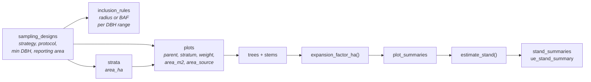

# Sampling designs and stand summaries

How the database records how an inventory was sampled, and how it turns single trees into
per-hectare stand values with their sampling error. Migrations `20261102130000_sampling_designs`
(XRFF-626) and `20261102140000_stand_summaries` (XRFF-627). Why it is built this way, and the
sources it follows (Open Foris Collect and Arena, FIA, COST E43), are in the knowledge hub,
`03-DATA-TIER/adoption-readiness-and-aggregation`.

## The model



| Object | Holds |
|---|---|
| `shared.sampling_designs` | one inventory protocol: `strategy` (`census`, `simple_random`, `systematic`, `stratified_random`, `stratified_systematic`, `two_phase`), protocol name and version, DBH measuring height (default 1.3 m), minimum DBH, reporting area in ha |
| `shared.inclusion_rules` | per design and DBH range (`min_dbh_cm` inclusive, `max_dbh_cm` exclusive): a `fixed_radius` (`radius_m`) or an `angle_count` (`basal_area_factor_m2ha`). One rule = fixed-radius plot; several = nested circles; mixed = e.g. the German national inventory (small circle for thin trees, angle count above). Ranges of one design must not overlap. A design **without** rules uses each plot's own area |
| `shared.strata` | strata of a stratified design, with `area_ha` |
| `shared.plots` | gains `sampling_design_id`, `stratum_id` (must belong to the design), `parent_plot_id` (cluster → plot → subplot, or site → label plots), `sampling_weight` (default 1) and `area_source` (`surveyed`, `nominal`, `convex_hull`) |
| `trees.stems.dbh_measuring_height_m` | only when a stem was measured at a different height than the design's |

All are readable by everyone and written by contributors, through the views of the same name
(`/rest/v1/sampling_designs`, `/inclusion_rules`, `/strata`, `/plots`).

## Fully mapped sites

A site where every tree is mapped is a **census**. `scripts/seed/census_site_plots.sql` gives
each such site the design `full_census` and one plot `<location>_site` whose area is the convex
hull of the measured baseline's stem positions (`area_source = convex_hull`, the outline
silva-connector uses for stand area). The site's existing plots hang under it as labels. Run it
after the baseline seeds (RUNBOOK §3); it is idempotent.

| Site | Census area | Plots attached |
|---|---|---|
| Ecosense | 2.891 ha | 18 |
| Mathisle | 1.173 ha | 1 |

## Expansion factor

`shared.expansion_factor_ha(plot_id, dbh_cm)`: the trees per hectare one tree stands for.

| Case | Factor |
|---|---|
| fixed radius r | 10000 / (π r²) |
| angle count, basal-area factor BAF | BAF / g, with g = π (DBH / 200)² the tree's basal area in m², so every counted tree adds exactly BAF m²/ha |
| design without rules | 10000 / plot area in m² |

Design and area come from the tree's plot or, where it has none, from the nearest enclosing
plot. NULL when unknown: no plot, no area, no DBH where a rule needs one, a DBH outside every
rule or below the design's minimum. The sampling weight is not part of it. Per tree:
`/rest/v1/tree_expansion_factors?variant_id=eq.<id>`.

## Per-plot summaries

`/rest/v1/plot_summaries?variant_id=eq.<id>`: one row per sample unit, variant and species.

- **Sample unit:** the tree's own plot in a design with inclusion rules; otherwise the nearest
  plot up the chain with an area (on a fully mapped site, the census plot).
- **Trees counted:** living trees only. Excluded are the statuses dead, harvested, missing and
  downed; a tree with no status counts as living.
- **Values:** `stems_ha`, `basal_area_m2ha` (all stems of a tree), `volume_m3ha`,
  `biomass_tha` and `carbon_tha`, each the sum of the tree value × its expansion factor.
- **Incomplete values:** a value is NULL when any counted tree lacks it, so a partial sum
  never passes for a complete one. `trees_measured` and `trees_without_expansion_factor`
  show the counts.
- **All species:** sum the species rows of a plot for the all-species value.

## Estimates and their accuracy

`shared.estimate_stand(design_id, variant_id, by_species = false, confidence = 0.95)`,
over REST:

```bash
curl -X POST "$API/rest/v1/rpc/estimate_stand" -H "apikey: $ANON_KEY" \
     -H "Content-Type: application/json" \
     -d '{"p_sampling_design_id": 9, "p_variant_id": 2, "p_by_species": false, "p_confidence": 0.95}'
```

One row per variable (and species when `by_species`). A unit without trees counts as zero; by
species, a unit without that species counts as zero for it.

| Strategy | Estimate | Variance |
|---|---|---|
| `census` | area-weighted mean of the census units | none: no sampling error |
| `simple_random` | ȳ = Σ wᵢyᵢ / Σ wᵢ (w = `sampling_weight`) | n/(n−1) · Σ (wᵢ(yᵢ − ȳ))² / (Σ wᵢ)² |
| `systematic` | as simple random (stated in `method`; usually overstates the error) | as simple random |
| `stratified_random`, `stratified_systematic` | Σ Wₕ ȳₕ with Wₕ = stratum area / total strata area | Σ Wₕ² varₕ, varₕ as simple random within the stratum |
| `two_phase` | not estimated yet: values NULL, reason in `method` | |

Variances are with replacement and without finite population correction, as R `survey`'s
`svymean` computes them by default and as Open Foris Arena reports. The tests check the
results against R `survey`.

Accuracy is reported the ways forestry reports it:

| Column | Meaning |
|---|---|
| `standard_error` | SE of the per-hectare estimate |
| `relative_standard_error_pct` | 100 · SE / estimate |
| `margin_of_error` | t · SE, the half-width of the confidence interval |
| `sampling_error_pct` | 100 · t · SE / estimate: the usual "± x % at 95 %" |
| `ci_low`, `ci_high` | estimate ∓ margin of error |
| `confidence` | 0.90, 0.95 or 0.99; t is Student's t with n − 1 degrees of freedom (n − number of strata when stratified), from a table checked against R `qt()` |
| `n_units`, `area_ha` | sample units used; census or strata area |
| `total`, `total_standard_error` | estimate × the design's `reporting_area_ha`, else the strata or census area |
| `method` | which estimator was used, in words |

## Stand summaries for every variant

`/rest/v1/stand_summaries?variant_id=eq.<id>` returns every sampling design of the variant's
site, all species (`by_species = false`) and per species, at 95 %, with location, scenario,
variant and species names. Unreal reads the same rows as `ue_stand_summary`:

```
GET /rest/v1/ue_stand_summary?variant_id=eq.<id>&by_species=is.false
```

Because SILVA variants are tree rows like the baseline, the same view gives each scenario's
per-hectare trajectory. On the census sites the values equal silva-connector's stand values.
Always filter on `variant_id`: one variant takes about 0.1 s; all forest states of all sites
(about 7,000 rows) take about 12 s, longer than the 3 s an anonymous request may run, so an
unfiltered download of this view fails. `plot_summaries` and `tree_expansion_factors` are
fast without a filter too: they resolve each plot once (`shared.plot_inclusion`) rather than
per tree. Filter on the id itself, not through a join: in SQL,
`WHERE s.variant_id = (SELECT … )` is fast, while `JOIN shared.variants v … WHERE v.location_id = …`
computes every variant before filtering (measured: about 2 s against 2 minutes).

## Recording a sampled inventory

1. Create the design (`POST /rest/v1/sampling_designs`): strategy, protocol, minimum DBH,
   reporting area.
2. Add its inclusion rules (`POST /rest/v1/inclusion_rules`), or none for fixed-area plots.
3. For a stratified design, add the strata with their area (`POST /rest/v1/strata`).
4. Create the plots with `sampling_design_id`, `stratum_id` and, for fixed-area plots,
   `area_m2`; clusters as parent plots.
5. Import the trees with their `plot_id` and stem DBH.
6. Read `stand_summaries` or call `estimate_stand`.

## Limits

- Areas are horizontal: there is no slope correction.
- There is no edge correction for plots that cross a stand boundary.
- Cluster designs are estimated with plots, not clusters, as units, which understates the
  error when plots of a cluster are alike.
- Two-phase sampling and post-stratification are not estimated.
- The database estimates; it does not simulate sampling. Comparing designs with synthetic
  plots is out of scope.
